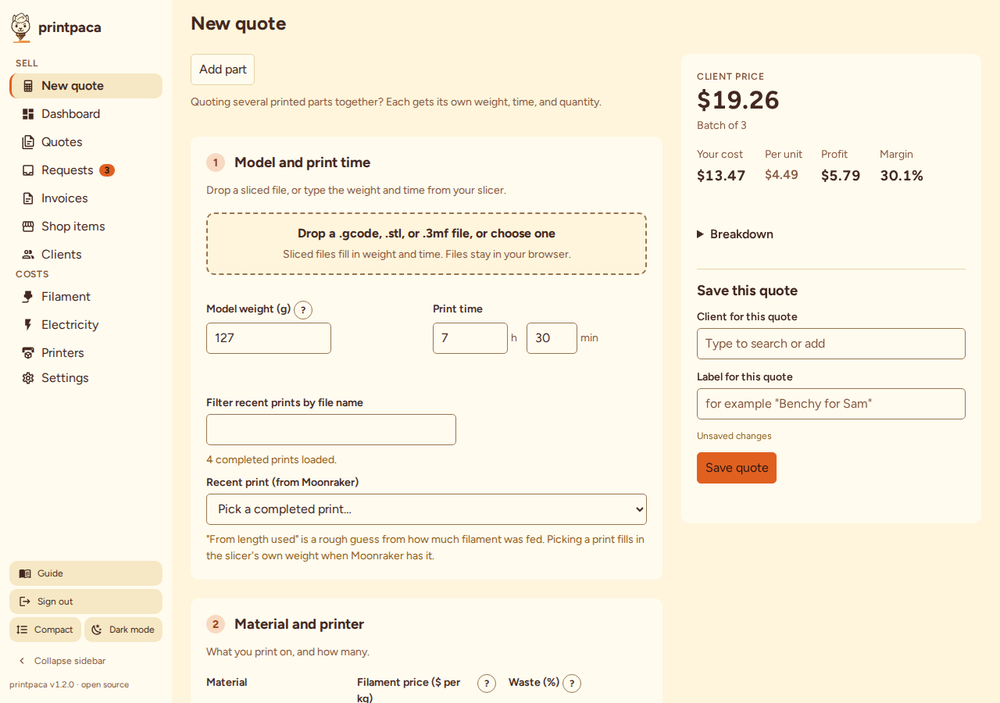
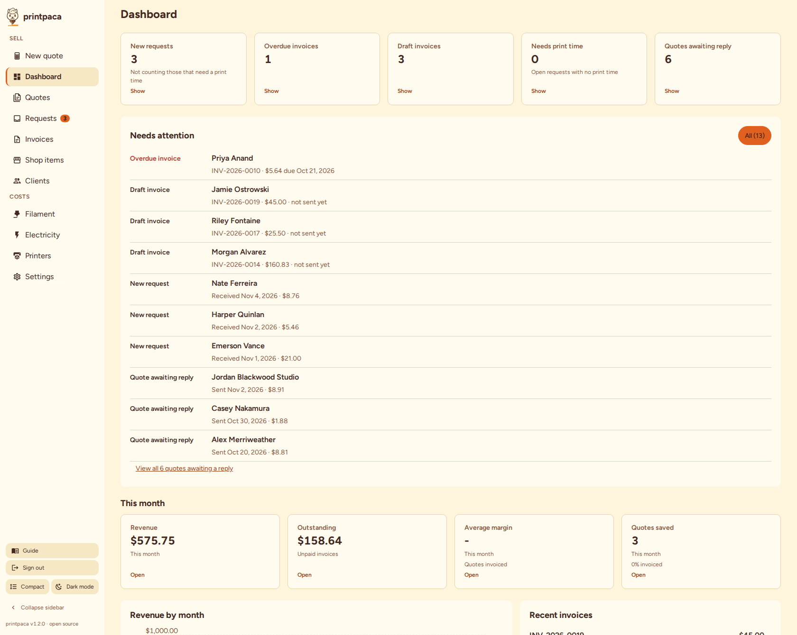
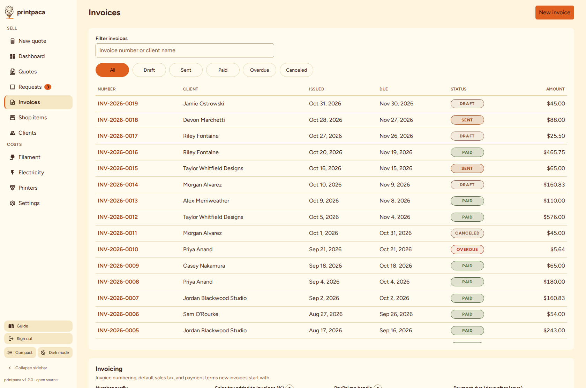
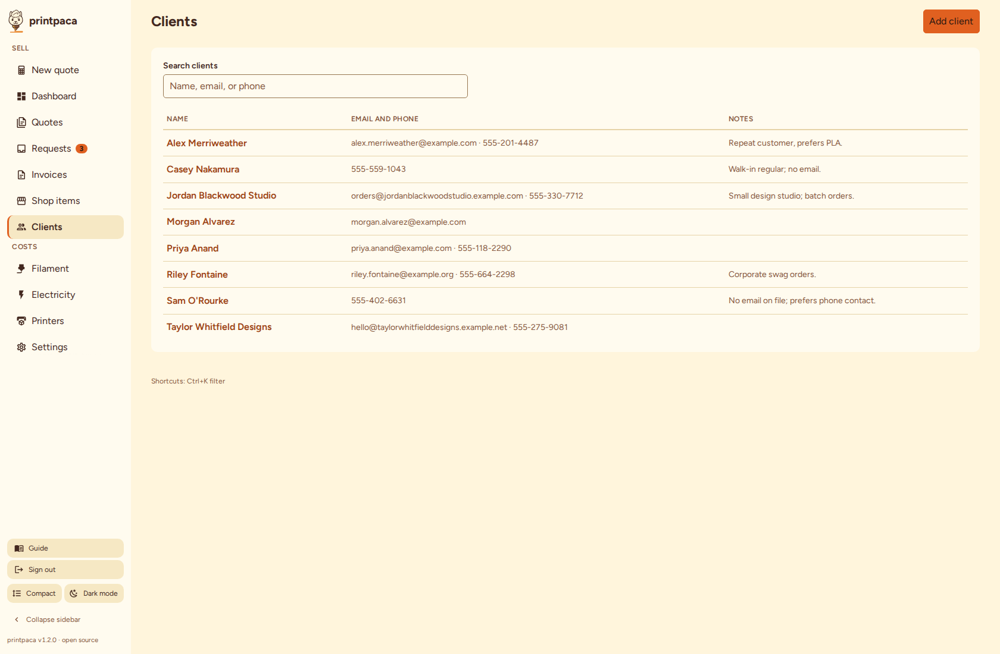
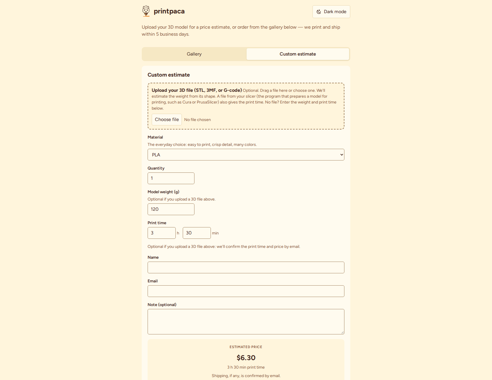
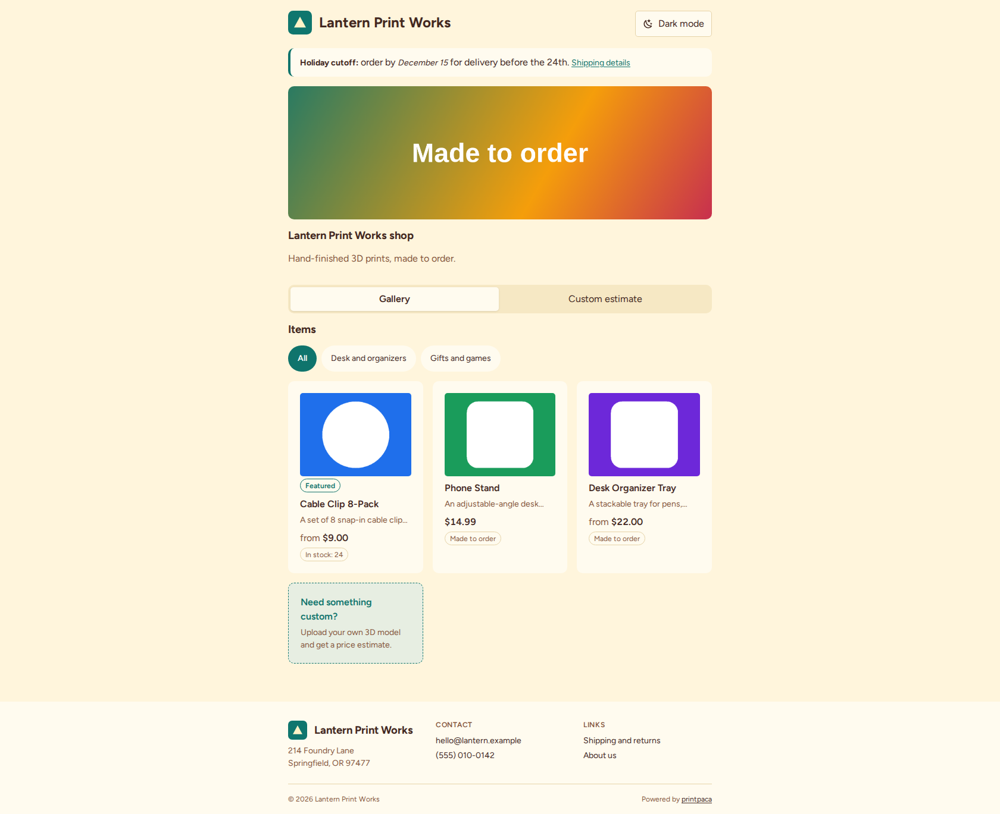
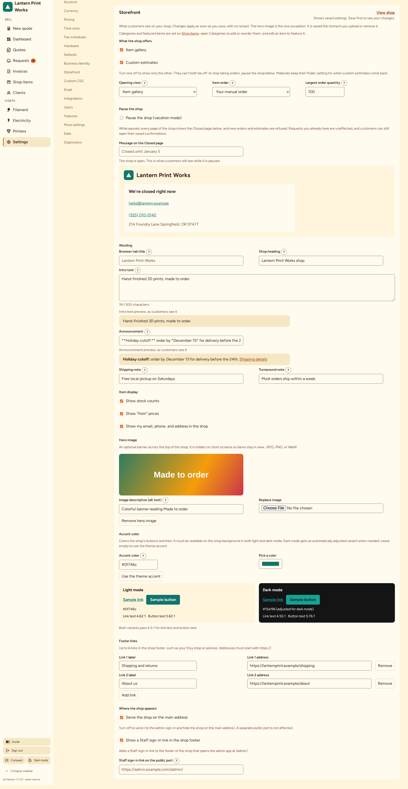
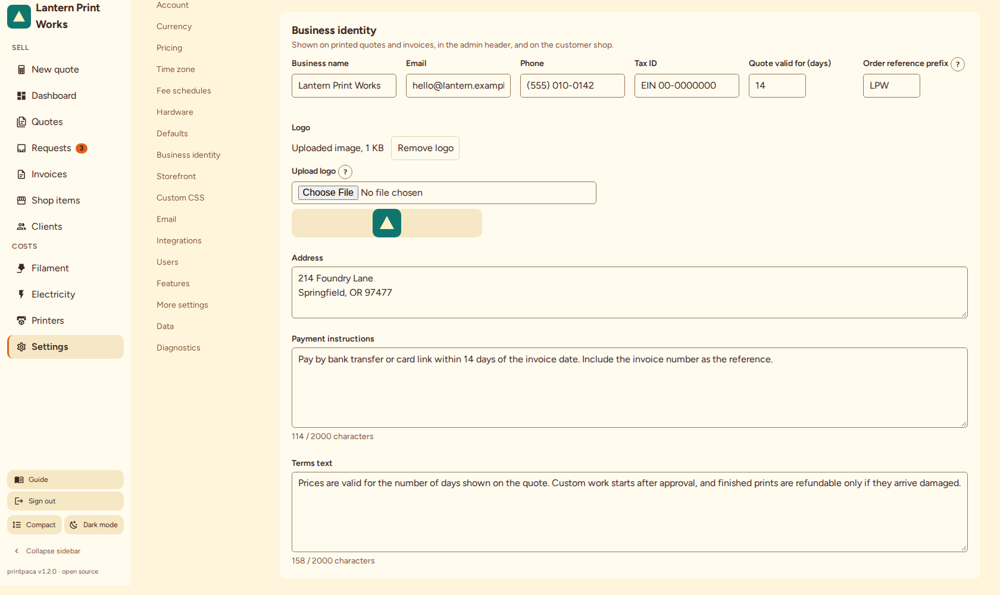

#  printpaca

A self-hosted, open-source 3D print cost and quote calculator: transparent formulas, full configurability, single small Docker image.

printpaca was developed with AI assistance.

**Live demo:** try the [admin app](https://demo.printpaca.com/admin/) (password `demo`) and the [customer shop](https://demo-cust.printpaca.com/). It's read-only and seeded with fake data. You can also [run the demo yourself](docs/demo.md).

[](docs/screenshot.png)

## Documentation

- [Getting started](docs/getting-started.md): install Docker, start printpaca, back up, update. Written for people new to Docker.
- [Configuration](docs/configuration.md): the Settings tab, `config.yaml`, every environment variable, authentication, the [storefront settings](docs/configuration.md#storefront), the public quote page, and running behind a reverse proxy.
- [Cloudflare Tunnel](docs/cloudflare-tunnel.md): put printpaca on one real hostname, and protect the admin app with Cloudflare Access. Optional, and recommended for remote access.
- [Formulas](docs/formulas.md): every cost and pricing formula, with units and assumptions.
- [Accessibility](docs/accessibility.md): the WCAG 2.2 AA target, how it's tested (automated checks and a simulated review, with no human or screen-reader testing), keyboard and screen-reader behavior, known limitations, and how to report a problem.
- [Architecture](docs/architecture.md), [CONTRIBUTING.md](CONTRIBUTING.md), and [SECURITY.md](SECURITY.md) for contributors.

## Features

| Area | Capabilities |
|---|---|
| Quoting | A print-cost calculator: material, electricity, machine depreciation, failure buffer, prep labor, and overhead. Electricity can be per-material waste, flat, simple time-of-use, or a full time-of-use schedule with seasons, windows, holidays, and a print start. Multi-part quotes hold up to 20 parts, each with its own weight, time, material, and quantity, and apply fees, tax, and shipping once. A hardware add-on catalog attaches to admin quotes only (see [Hardware scope](docs/formulas.md#hardware-scope)). |
| Pricing | Margin or markup pricing, and named marketplace fee schedules with a provenance note. Shipping you charge (revenue) and shipping you pay (expense) are tracked separately, so under-charged shipping shows up as a real loss. |
| Files and integrations | A G-code drop zone reads slicer-reported weight, length, and time (Cura, PrusaSlicer, OrcaSlicer/Bambu, Snapmaker Orca), and estimates weight from STL and 3MF files. Optional Spoolman integration (spool picker, low-material warnings, and an inventory card on the Filament tab). Optional Moonraker integration (prefill a quote from a completed print) and a Fluidd sidebar link. Integration URLs are settable in Settings or by environment variable, with a Test button, and apply without a restart. |
| Business records | Quote history with JSON export and import. Printable and emailable quotes with your branding. Client records. Numbered invoices with line items, discounts, US sales tax, a payment register, and an optional PayPal.me link and QR code, convertible from a saved quote. Invoice lines can link to shop items, so sending takes stock off the shelf. A Dashboard with five action tiles (new requests, overdue and draft invoices, requests that need a print time, and quotes awaiting a reply), a to-do list, this month's revenue and margin, a revenue chart, and a Top items panel. |
| Public shop | A shop at `/` with an item gallery and a custom estimate form. Items have images, option groups, stock modes, categories, and a featured flag. Customers see "from" prices until they pick options. Orders and estimates land in Requests for your review, and stock decrements when you finalize an order. The Storefront settings control what the shop offers, a hero image, an accent color checked for contrast, the heading, the intro and announcement (with light markdown), footer links, and a pause switch that shows a Closed page. See [Storefront](docs/configuration.md#storefront). |
| Interface | One layout system across every screen. The New quote page has the form on the left and a summary that stays in view on the right. Lists scroll inside a window with a fixed header. Comfortable or Compact density, light or dark theme, and a built-in Guide with screenshots. Mobile navigation, and an installable Progressive Web App (needs HTTPS or `localhost`; it silently no-ops on plain-HTTP LAN deployments). |
| Accessibility | A WCAG 2.2 Level AA target for the admin app, the sign-in screen, and the shop. An axe-core check in CI scans both themes. A simulated persona review covered v1.2. **No human participants or screen-reader users have tested printpaca.** See [Accessibility](docs/accessibility.md) for coverage and known limitations. |
| Operations | Edit the full configuration in the browser; printpaca validates it like `config.yaml` and applies it with no restart. One scratch-based container of about 18 MiB uncompressed rootfs (CI fails the build above 20 MiB; see `scripts/check-image-size.sh`). The compose files cap memory at 128 MiB. |

<table>
<tr>
<!-- Each thumbnail links to its full-size capture: at width="400" the text in these 1680px screenshots is unreadable, so the link is the preview mechanism, not decoration. -->
<td>
<a href="docs/screenshots/dashboard.png"></a>
</td>
<td>
<a href="docs/screenshots/invoices.png"></a>
</td>
</tr>
<tr>
<td>
<a href="docs/screenshots/clients.png"></a>
</td>
<td>
<a href="docs/screenshots/public-quote.png"></a>
</td>
</tr>
<tr>
<td>
<a href="docs/screenshots/shop.png"></a>
</td>
<td>
<a href="docs/screenshots/storefront.png"></a>
</td>
</tr>
<tr>
<td>
<a href="docs/screenshots/business-identity.png"></a>
</td>
<td></td>
</tr>
</table>

## Quick start

```bash
docker run -p 127.0.0.1:8080:8080 skilledalpaca/printpaca:latest
```

`latest` tracks the newest stable release on Docker Hub; pin a tag such as `skilledalpaca/printpaca:vX.Y.Z` to control upgrades. To build from source instead:

```bash
docker build -t printpaca . && docker run -p 127.0.0.1:8080:8080 printpaca
```

Open `http://localhost:8080/admin/` for the admin app. Customers see the shop at `http://localhost:8080/`. The older address `http://localhost:8080/order` shows the same page. With no `ADMIN_PASSWORD` set, the container generates a random password on first start and prints it once in `docker logs`, on a line starting `printpaca: Use this password to sign in:`. See [Authentication](#authentication).

With no `-v` flag the container uses an anonymous volume that survives restarts but not recreation (`docker rm` plus a fresh `run`). The container runs as the non-root user `65532:65532`, so for a bind mount that survives recreation, own the directory first:

```bash
mkdir -p ./config && sudo chown 65532:65532 ./config
docker run -p 127.0.0.1:8080:8080 -v ./config:/config skilledalpaca/printpaca:latest
```

On Docker versions before 23, use an absolute path: `-v "$PWD/config":/config`.

Without the `chown`, the container exits at start with a log line naming the directory, the uid it needs, and the fix; see [Getting started](docs/getting-started.md#common-failure-config-folder-permissions).

### Docker Compose

```bash
docker compose up -d --build
```

[`docker-compose.yml`](docker-compose.yml) uses the bind mount `./config:/config`, so data survives `docker compose down`. Create and own `./config` as above before the first `up`. The compose file publishes on loopback only; uncomment the LAN alternative in the `ports:` block to reach it from other devices. With no `ADMIN_PASSWORD`, the generated password also lands in `./config/admin-password`. To set environment variables, uncomment the `environment:` block; the [environment variable table](docs/configuration.md#environment-variables) lists them. An optional `cloudflared` service (`docker compose --profile tunnel up -d`) publishes printpaca on one hostname without port forwarding; see [Cloudflare Tunnel](docs/cloudflare-tunnel.md).

The compose file builds from source by default. To run the published image, comment out the `build:` and `image:` lines, use `image: skilledalpaca/printpaca:latest`, then run `docker compose pull && docker compose up -d`.

## Hosting options

printpaca serves everything from one port (`PORT`, default `8080`): the shop at `/` (and at `/order`, so old links work), and the admin app and its API under `/admin/`. Point one hostname at that port. Pick how traffic reaches it:

| Option | Use it when | Details |
|---|---|---|
| LAN only | Only you and your staff use printpaca, on your own network. | [Quick start](#quick-start) and [Getting started](docs/getting-started.md). |
| Your own reverse proxy with TLS | You run nginx or Caddy and want HTTPS on a hostname you control. | [Running behind a reverse proxy](docs/configuration.md#running-behind-a-reverse-proxy-https). |
| Cloudflare Tunnel (recommended) | You want customers and remote staff to reach printpaca with no port forwarding. Add Cloudflare Access on the path `/admin` to protect the admin app. | [Cloudflare Tunnel](docs/cloudflare-tunnel.md). |

If you want a listener that serves only customer pages, set `PUBLIC_PORT`; see [Public quote page](docs/configuration.md#public-quote-page).

## Requirements

- Docker, or any host that runs the single static binary.
- A current browser for the web UI: Chrome or Edge 116, Firefox 124, or Safari 17.4, or newer. The build targets exactly these versions.

## Configuration

Every setting has a built-in default, so you can start quoting immediately. Edit settings in the Settings tab, or copy [`config/config.example.yaml`](config/config.example.yaml) into your config directory as `config.yaml`. [Configuration](docs/configuration.md) covers merge rules, validation, every environment variable, and the integrations.

## Authentication

The admin app (`/admin/` on `PORT`) requires a login by default, with a generated or chosen `ADMIN_PASSWORD`. Every request on `PORT` also passes a `Host` allowlist (`ALLOWED_HOSTS`, a DNS-rebinding defense), and `/admin/` adds a CSRF origin check and login rate limits. Setting `ADMIN_PASSWORD=` (empty) is the only way to disable authentication.

Behind a Cloudflare Tunnel, protect `/admin/` with Cloudflare Access (`CF_ACCESS_TEAM` and `CF_ACCESS_AUD`). Without Access, the printpaca password is the only lock, and with authentication disabled, `/admin/` answers `403`. See [Cloudflare Tunnel](docs/cloudflare-tunnel.md).

The shop and `/api/public/*` are anonymous and carry no admin capability. See [Authentication](docs/configuration.md#authentication) for the full list, and [Multi-user mode](docs/configuration.md#users) for employee accounts.

## Philosophy

[`docs/formulas.md`](docs/formulas.md) writes out every formula printpaca uses, with units and assumptions. A frozen golden-vector test suite pins the math, so a change that breaks it fails the suite instead of drifting from what's documented.

**Estimates only.** printpaca computes estimates from the inputs and configuration you give it. It doesn't know your actual material waste, your power company's billing quirks, or your marketplace's current fees. Verify taxes, marketplace fees, and business costs against your own records before relying on a quote commercially.

## Development

You need Node 26 (pinned in `.nvmrc` and `package.json`) and Go 1.26.10 or later (the floor in `server/go.mod`).

```bash
npm install                 # installs the web workspace
npm test                    # web unit suite (vitest)
npm run check -w web        # svelte-check
npm run lint:css            # raw spacing and width literals: blocks in migrated files, warns elsewhere
(cd server && go test ./... -race)   # Go unit suite
npx playwright install --with-deps chromium  # one-time: browser for npm run e2e
npm run e2e                  # Playwright end-to-end (builds a real binary, starts servers with the main port on :8099, :9099, and :9199 and a customer-only listener beside each on :8098, :9098, and :9198, and runs the axe accessibility gate)
docker build -t printpaca .  # full multi-stage image build (runs all tests inside the build)
bash scripts/check-image-size.sh printpaca   # enforce the uncompressed size gate
```

**Admin app with live reload.** `go run .` alone doesn't serve the real web UI: `server/embedded/dist` is a tracked placeholder, and the real build lands there only during `docker build` or `scripts/e2e-server.sh`. Run the Go server and the Vite dev server side by side:

```bash
# terminal 1: the API (CONFIG_DIR must be writable; the default /config isn't, off a container)
mkdir -p /tmp/printpaca-dev && cd server && CONFIG_DIR=/tmp/printpaca-dev go run .

# terminal 2: the UI, with hot reload
npm run dev -w web
```

Open the URL Vite prints (typically `http://localhost:5173`). Vite proxies `/api/*` to `/admin/api/*` on `http://localhost:8080`, because the production admin app calls its API under `/admin/`. The proxy covers the admin app only, so this flow can't exercise the shop at `/`.

To run the built app, use `bash scripts/e2e-server.sh` (main port on `:8099` with the admin app at `/admin/`, and the customer-only listener on `:8098`). It builds the web assets, copies them into `server/embedded/dist` just long enough to compile a binary, restores the placeholder, and runs the binary against a throwaway config directory. `npm run e2e` runs the same script (see [`e2e/playwright.config.ts`](e2e/playwright.config.ts)).

See [`CONTRIBUTING.md`](CONTRIBUTING.md) for the house rules, [Accessibility](docs/accessibility.md#contributor-guidance) for the accessibility conventions, and [`SECURITY.md`](SECURITY.md) to report a vulnerability.

**CI.** GitHub Actions ([`ci.yml`](.github/workflows/ci.yml)) runs the test gates, then builds a multi-arch (amd64 and arm64) image by cross-compilation, with no emulation, and checks it against the size gate. On a `v*` tag it pushes the image to Docker Hub (`skilledalpaca/printpaca`).

**Packaging.** `packaging/unraid/` holds the Unraid Community Applications template.

## License

[AGPL-3.0-or-later](LICENSE). Copyright (c) 2026 Trenton (SkilledAlpaca) and printpaca contributors. If you modify printpaca and let others interact with it over a network, including running a hosted or modified version for your own customers, you must offer those users the corresponding modified source. The shipped image also bundles third-party code (Go modules statically linked into the server binary, npm packages bundled into the web build); see [THIRD_PARTY_NOTICES.md](THIRD_PARTY_NOTICES.md) for the attribution list.
