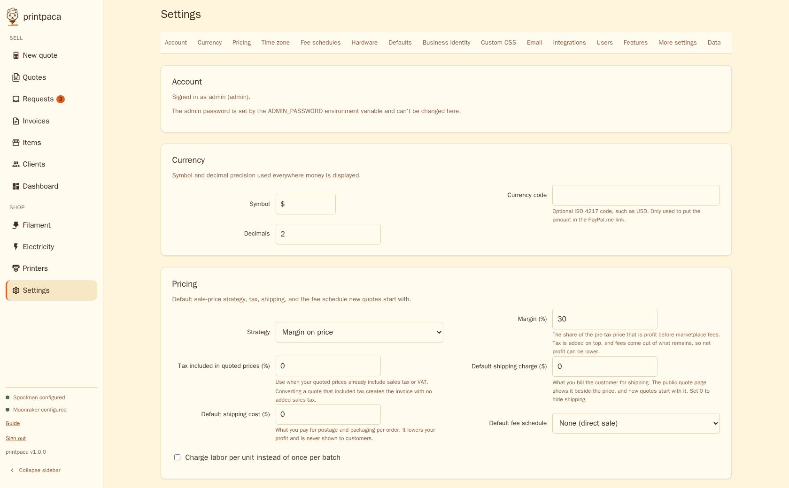
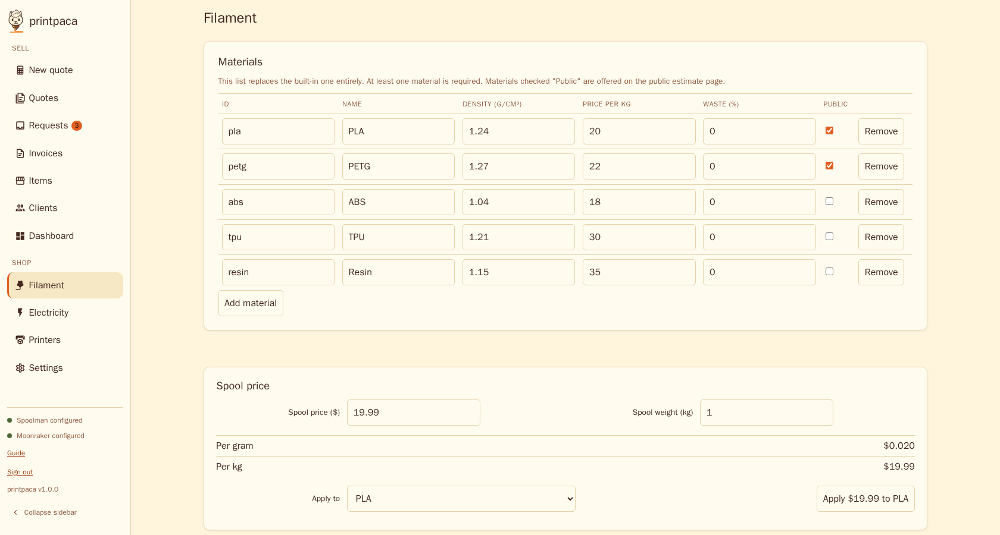
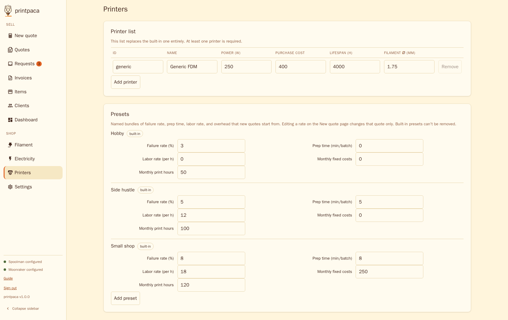
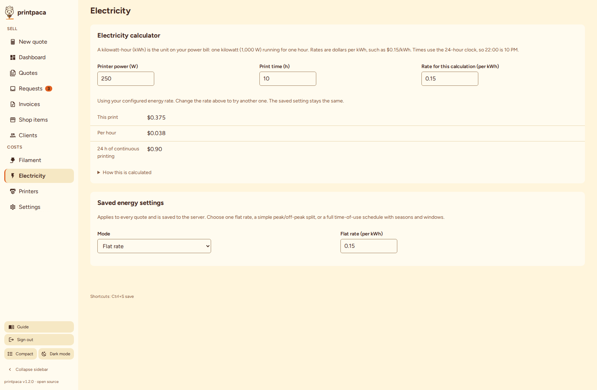
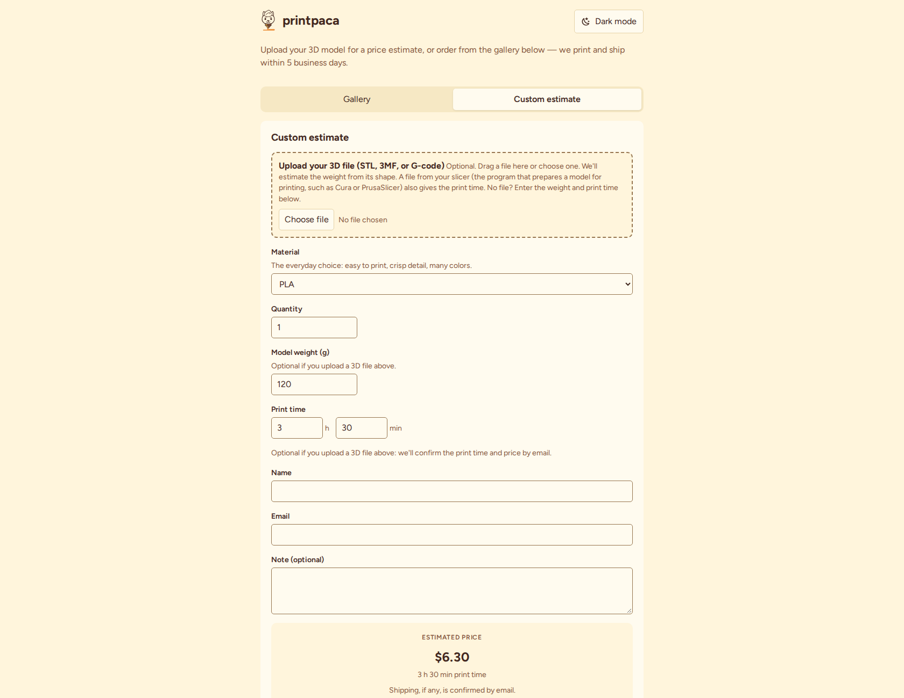
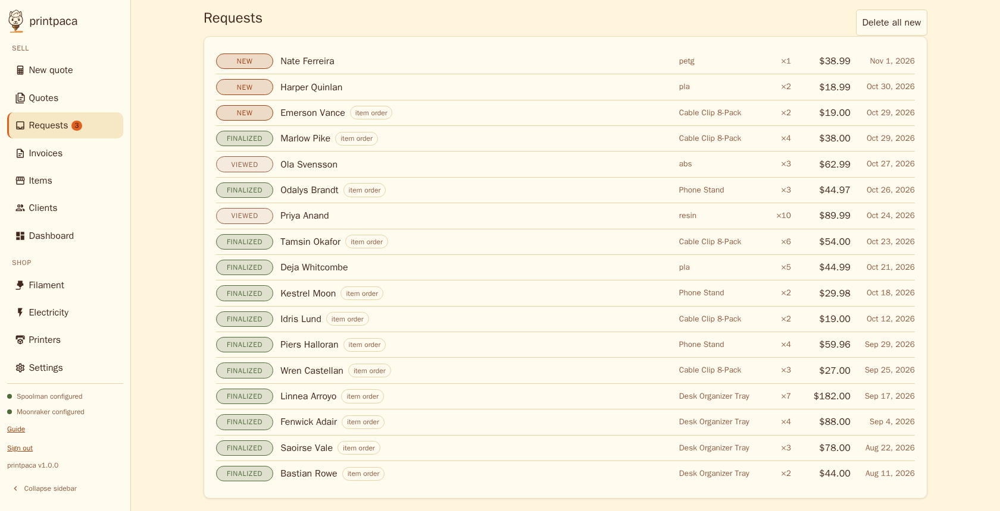
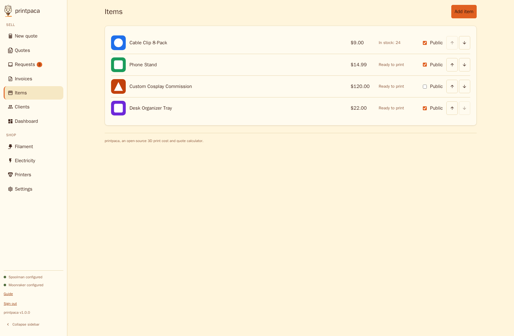

# Configuration

You configure printpaca from the **Settings** tab in your browser. Every value on that page maps to a key in `config.yaml`, an optional file you can edit by hand. A few settings exist only as [environment variables](#environment-variables), because a browser can't change them while the server runs, such as which port it listens on.

If you haven't run printpaca yet, see [Getting started](getting-started.md).



## The Settings tab, section by section

Open **Settings** in the sidebar. A jump nav at the top links to each section below.

### Currency

The currency symbol (for example `$`) and how many decimal places to show, used everywhere printpaca displays money. The optional **Currency code** (an ISO 4217 code such as `USD`, three uppercase letters) doesn't change how money displays; it only puts the amount into the [PayPal payment link](#paypal-payment-link-on-invoices).

### Pricing

What a new quote starts with:

- **Strategy**: **Margin on price** sets your selling price so a given percentage of the pre-tax price is profit, then adds your tax rate on top; **Markup on cost** multiplies your cost by a fixed number instead (and also adds tax). Marketplace fees come out of the result, so net profit can fall below the margin you set.
- **Tax rate**, **default shipping charge**, **default shipping cost**, and **default fee schedule** (see [Fee schedules](#fee-schedules) below, or **None (direct sale)** for no marketplace fees). The **shipping charge** is what you bill the customer: the public quote page shows it beside the price, a new quote starts with it as its shipping charge, and a request converted to an invoice gets a matching Shipping line (untaxed). It is 0 by default, which shows no shipping. The **shipping cost** is the postage you pay, an expense that lowers your profit and is never shown to customers. The two are separate settings.
- **Charge labor per unit instead of once per batch**: a checkbox for whether prep labor is charged once per batch order or multiplied by quantity.

### Time zone

The **Time zone** card sets the top-level `timezone` key: an IANA name such as `America/New_York`, `Europe/Berlin`, or `UTC` (the default). It decides which calendar day and month your Dashboard uses for "Revenue this month", the 12-month chart, overdue invoices, and quotes saved this month, and the date a **Mark paid** balancing payment gets. printpaca stores every timestamp in UTC; only these calendar boundaries follow your zone. Without it, a payment recorded on the evening of the last day of the month in the Americas lands in the next month. An unknown name is rejected when you save. The zone database is built into printpaca, so the setting works in the container image without any extra packages. See [Dashboard in formulas.md](formulas.md#dashboard) for exactly what each tile counts.

### Fee schedules

Marketplace fee breakdowns (a flat listing fee plus a percentage of revenue, for example), so a quote can show what a marketplace like Etsy or eBay would actually take. Built-in schedules can't be removed, but you can add your own with the **Add fee schedule** button.

### Hardware

The reusable add-on catalog: a name, a unit cost, and a **lost on failure** flag per entry (see [formulas.md](formulas.md#hardware-scope)). Attached to a quote at a quantity per unit on the admin **Quote** tab and priced into the same formula as material and electricity. Hardware is admin-quote-only: it's never reachable from the public quote page or item gallery.

### Defaults

The preset, printer, material, failure rate, and quantity a brand new quote starts with.

### Business identity

Your business name, logo, contact details, tax ID, and how many days a quote stays valid. Printed on quotes and invoices, along with payment instructions and terms text you write here.

You can paste a logo URL, or upload a PNG, JPG, WebP, or SVG image of up to 64 KB with a preview before you save. An uploaded logo is stored in `config.yaml` as a `data:` URL in `quote.logoUrl`, so backups and the demo carry it with the rest of your settings. Larger pictures are shrunk to fit; an SVG over the limit is refused. **Remove logo** clears it.

**Order reference prefix** (`quote.referencePrefix`) starts the short reference a customer sees after sending an order or estimate, such as `HL-1001`, so they can quote it by phone. Leave it blank to use your business initials: two or more words give their initials (Hot Layer Prints becomes `HLP`), one word gives its first three letters, and no usable letters gives `REQ`. Set it to 1 to 10 letters or digits to choose your own. The numbers count up per shop, starting at 1001, across orders and estimates together. Changing the prefix keeps the count going under the new prefix, and references already issued keep the prefix they had. The Requests tab still identifies each request by its long internal ID.
The business name and logo also appear on the shop, and in the admin app: the sidebar (and the top bar on a phone) shows them in place of the printpaca name and mark, the browser tab title ends with the name, and a logo that fails to load falls back to the printpaca mark. They update when you save Settings, with no reload. In the admin app, the name and logo are a link to the first tab (usually New quote). The shared footer on every customer page shows your **email**, **phone**, and **address** when you set them here (the `quote.email`, `quote.phone`, and `quote.address` keys in `config.yaml`), as a `mailto:` link, a `tel:` link, and plain text. The footer also shows a **Staff sign-in** link when [`site.staffLink`](#site-settings) or `site.adminUrl` provides one. The tax ID, payment instructions, and terms text stay private.

### Custom CSS

Your own CSS, saved to the top-level `customCss` key in `config.yaml` and served verbatim and unsanitized, because it's CSS you wrote for your own instance, the same trust level as every other free-text field on this page. It applies on two surfaces:

- The shop (see [Public quote page](#public-quote-page)), loaded on screen after the page's own stylesheets, so it can override theme tokens like `--accent` or target any selector on those pages.
- Printed quotes and invoices, loaded with `media="print"` by the admin app. It never touches the on-screen admin UI, only what comes out of **Print client quote**, **Print cost audit**, and an invoice's own print view. Target `#print-view.quote` for printed quotes, `#print-view.invoice` for printed invoices, or `#print-view` for both.

The customer pages load the stylesheet from `GET /custom.css`, and the admin app loads its print copy from `GET /admin/custom.css`.

### Email

SMTP settings for two things: an email to you every time someone submits a request on your [public quote page](#public-quote-page), and sending quotes or invoices to clients from the Quotes and Invoices tabs. Leave **Host** empty to turn both off. The password itself isn't set here: it comes from the `SMTP_PASSWORD` environment variable, and changing it requires restarting printpaca (unlike every other setting on this page, which applies immediately). If you set a **Username** but leave `SMTP_PASSWORD` unset, printpaca logs a warning at startup (and again after you save) and attempts to send unauthenticated, which most SMTP relays reject. If **Send test email** fails with an authentication error, check `docker compose logs printpaca` for that warning first. Use **Send test email** to confirm your saved settings work before relying on them.

By default, printpaca upgrades the connection with STARTTLS when your mail server advertises it, and sends in plaintext when it doesn't. A network path that strips the advertisement can silently downgrade the connection and expose your SMTP credentials and message contents. Set `requireTLS: true` under `smtp:` in `config.yaml` (the Settings page has no toggle for it) to refuse to send without STARTTLS. Turn it on only after you confirm your mail server advertises STARTTLS, or every send fails.

### Users

By default, printpaca runs in **single-user mode**: everyone who knows `ADMIN_PASSWORD` has full access, and the sign-in screen asks for a password only. Check **Multi-user mode** and save to add employee accounts, each limited to the tabs you grant.

Turning multi-user mode off doesn't delete employee accounts. Their logins stop working and their sessions end immediately, and their accounts and grants return unchanged if you turn it on again. Multi-user mode requires authentication, because no admin account could manage employees otherwise. Any admin password satisfies this, including the generated one. Only the explicit opt-out `ADMIN_PASSWORD=` (empty) blocks it.

Once multi-user mode is on, this card also shows:

- A table of employee accounts: username, a checkbox grid of the ten grantable tabs (New quote, Quotes, Requests, Invoices, Items, Clients, Dashboard, Filament, Electricity, Printers), a disable toggle, a reset password button, and delete (with a confirmation step). This set differs from the [Features](#features) list: Guide is open to every signed-in user and Settings is admin-only, so neither appears here, while New quote is grantable here.
- An **Add employee** form: a username (lowercase letters, digits, `.`, `_`, `-`), a password (at least 8 characters), an optional Cloudflare Access email, and the same checkbox grid.
- An optional **Email** per employee and a **Your Cloudflare Access email** field (`users.accessAdminEmail`), used only when you reach printpaca through [Cloudflare Access](#cloudflare-access-remote-admin-access). The admin email signs in as the admin; an employee's email signs in as that employee. Emails are stored lowercase, must look like an address (at most 254 characters), and each employee email must be unique. A person whose email matches nobody sees the normal sign-in screen.

A granted tab means full use of that tab; there's no finer-grained per-record permission. Employees change their own password on the **Account** card. You can reset it from this card, which also ends their other sessions, as does disabling or deleting an employee.

Some things stay admin-only no matter what you grant: this Settings tab, user management, the Integrations card and its test buttons, the Diagnostics export, and the Data export. An employee's own Settings tab shows only the **Account** card.

One narrow exception: the **Filament**, **Electricity**, and **Printers** tabs each embed a small settings form that has to read the full configuration to render. An employee granted one of those tabs can load its form but can only save keys that tab covers. Filament covers materials and the filament diameter field on Printers. Electricity covers energy rates. Printers covers the printer and preset lists, except a printer's filament diameter. Saving any other key, such as Business identity, Email, or Currency, is rejected.

With multi-user mode on, quotes, invoices, payments, clients, and items each show who created and last updated them ("Created by sam · Updated by admin") in their detail views. Records saved before you turned on multi-user mode show no attribution; new records are always stamped.

### Features

Checkboxes for which of the ten optional tabs (Quotes, Requests, Invoices, Items, Clients, Dashboard, Filament, Electricity, Printers, and Guide) show up in the sidebar. The New quote and Settings tabs can't be hidden.

Hiding a tab only removes it from navigation; its data stays intact. If you hide **Requests** while your [public quote page](#public-quote-page) is on, submissions keep arriving unseen until you re-enable it, so the page shows a warning.

### PayPal payment link on invoices

Set **PayPal.me handle** on the Invoices tab's Invoicing settings (or `invoicing.paypalMe` in `config.yaml`) to the handle part of your PayPal.me address: `yourshop` for `paypal.me/yourshop`. Enter 1 to 20 letters or digits, not the full URL.

With a handle set, every invoice that isn't canceled and still has a balance gets a **Pay with PayPal** block in its printed view (the link and a QR code) and in the invoice email (the link only). Paid and canceled invoices show nothing.

If you also set the **Currency code**, the link includes the balance, for example `https://paypal.me/yourshop/42.50USD`. The amount uses your **Decimals** setting, so a currency set to 0 decimals rounds the balance to a whole unit. Without a currency code the link has no amount and the invoice tells the customer how much to send.

printpaca never talks to PayPal: it only builds the link, so it can't tell when a customer has paid. Record the payment on the invoice as usual.

### More settings and Data

A few settings live on the tab they affect instead of on the Settings tab itself: materials on Filament, printers and presets on Printers, energy rates on Electricity, invoice numbering on Invoices, and the public quote page's printer/preset choice on Requests.



Material rows are read-only so a stray keystroke can't change what every quote costs. Press **Edit** on a row to change its name, price per kg, waste percentage, or Public checkbox, and **Done** to lock it again. The **Show ID and density (advanced)** checkbox adds the ID and density columns; a wrong density skews every price that uses the material by weight, so change it only when you know the figure.





The **Data** section at the bottom has a **Download data export** button. It exports your clients, invoices, payments, quotes, requests, items, and a snapshot of your settings (including the SMTP host and username, never `SMTP_PASSWORD` or the admin password) as one JSON file. Uploaded G-code, 3MF, and STL files and item images are not included. This export is one-way: printpaca can't import it. For a restorable backup, copy the `config` directory; see [Where your data lives](getting-started.md#where-your-data-lives) and [Restoring a backup](getting-started.md#restoring-a-backup).

Updates are one-way too: the database schema only grows forward, and an older binary refuses to open a newer database (`database schema version N is newer than this binary knows`). To roll back, restore a pre-update backup; see [Updating printpaca](getting-started.md#updating-printpaca).

### Time-of-use schedule

The Electricity tab's **Mode** list offers three choices: **Flat rate**, **Time-of-use (simple)**, and **Time-of-use schedule**. The simple mode blends a peak and an off-peak rate by an off-peak share that you estimate. The schedule mode prices each print by the hours it runs, so the print start changes the cost. See [Time-of-use schedule in formulas.md](formulas.md#time-of-use-schedule) for the math.

In schedule mode you edit the tariff on the Electricity tab (or Settings):

- **Default print start** is a 24-hour `HH:MM` time. New orders and public quotes start at the next time that clock time comes round.
- **Holidays** are dates written `YYYY-MM-DD`, one per line, up to 100. A holiday uses the weekend schedule.
- **Seasons** (up to 6) each have a name and the months they cover. Every month from 1 to 12 must belong to exactly one season.
- Each season has a **Weekday** and a **Weekend and holidays** schedule. Each has a base period name and rate, and up to 8 windows with a name, a start, an end (`24:00` is allowed), and a rate. Windows in one schedule can't overlap. Hours outside every window use the base rate.
- A window that runs past midnight, such as 22:00 to 06:00, is accepted. The editor explains that it will be split, and Save turns it into two windows with the same name and rate (22:00 to 24:00 and 00:00 to 06:00), because the server needs each window's start before its end.

The editor writes a problem in your terms, for example "Season 2 › Weekday › Window 1: enter a time like 16:00", marks the fields that need attention, and keeps **Save changes** disabled until the schedule is valid.

Times are wall-clock times in the [time zone](#time-zone) from Settings.

**Load SCE TOU-D-4-9PM example** fills in the structure of Southern California Edison's TOU-D-4-9PM plan: a summer season (June to September) and a winter season (October to May), each with weekday and weekend hours, an on-peak window from 4 to 9 pm, and a winter super off-peak window from 8 am to 4 pm. The rates it loads are examples, not SCE's published rates, which change. Check every rate against your own bill. If you already have a schedule, printpaca asks you to confirm before it replaces it. The structure comes from [SCE's time-of-use plans page](https://www.sce.com/save-money/rates-financing/residential-rate-plans/time-of-use-plans).

On **New quote**, the **Print start (order)** field defaults to the next default print start. Each part has an optional **Print start (this part)** field. The quote saves the starts you used, so a reopened quote prices the same. On the **Electricity** tab, the calculator takes a start, a duration, and the printer power, and shows how the hours split across periods.

The same keys in `config.yaml`:

```yaml
energy:
  mode: schedule
  schedule:
    defaultStartTime: "22:00"
    holidays: ["2026-12-25"]
    seasons:
      - name: Summer
        months: [6, 7, 8, 9]
        weekday:
          baseName: Off-peak
          baseRate: 0.33
          windows:
            - { name: On-peak, start: "16:00", end: "21:00", rate: 0.55 }
        weekend:
          baseName: Off-peak
          baseRate: 0.33
          windows:
            - { name: Mid-peak, start: "16:00", end: "21:00", rate: 0.44 }
```

printpaca rejects a schedule with a month in no season or in two seasons, overlapping windows, a start that isn't before its end, a time that isn't `HH:MM`, a negative rate, or more than 6 seasons, 8 windows per schedule, or 100 holidays. In `flat` and `tou` mode the schedule isn't used, and an empty one is accepted.

### Diagnostics

printpaca writes no log files; everything goes to stderr, which Docker collects. The **Export recent errors** button is the one in-app path to recent errors. It downloads the error-looking lines from a bounded in-memory ring buffer of about 4 MiB (`GET /admin/api/logs/errors`), pseudonymizing IP and email addresses. A restart clears the buffer. The button is unavailable in `DEMO_MODE`.

## Optional integrations

Each integration is opt-in: with its URL unset, the feature is absent from the UI.

You can set each of the three URLs below from the Settings page's **Integrations** card, as an alternative to the environment variable, for operators who can edit `config.yaml` through the UI but not the container's environment. The environment variable wins when both are set, and the card says so on a locked row. A saved URL applies right away, with no restart: printpaca reads the URL on every request. The card labels each row "Configured via environment" (locked), "Configured in settings", or "Not configured", and lists where the integration is used, with links. **Test** works on a locked row too: it checks the URL the environment variable sets (the request to `POST /api/integrations/test` sends an empty `url`, which the server resolves to the effective URL).

### Spoolman

[Spoolman](https://github.com/Donkie/Spoolman) is a self-hosted inventory tracker for 3D-printer filament spools. Set `SPOOLMAN_URL` (or the Settings page's Spoolman field) to the base URL of your Spoolman instance (for example `http://spoolman.local:7912`) to turn on two features:

- A spool picker on the New quote page, with warnings when a spool is running low on remaining material.
- A **Spoolman inventory** card on the Filament tab. It lists spool ID, vendor and filament name, material, colour, remaining grams, price, location, and archived state, with a filter box, a **Show archived** toggle, and **Refresh**. An admin can add a spool for an existing Spoolman filament, set the remaining weight, edit the location and price, and archive or unarchive a spool (archiving asks first). Employees with the Filament grant can view the inventory but not change it.

The Settings page can test a URL against Spoolman before you save it. A passing test reports what it found, for example "Connected. 14 active spools."; a failing test says what to check, in plain words (the URL, the port, or the network).

### Moonraker and Fluidd

[Moonraker](https://github.com/Arksine/moonraker) is the API server most Klipper-based 3D printers run alongside their firmware; [Fluidd](https://github.com/fluidd-core/fluidd) is a web interface built on top of it. Set `MOONRAKER_URL` (or the Settings page's Moonraker field) to your printer's Moonraker address (for example `http://printer.local:7125`) to add a **Recent print (from Moonraker)** picker to the New quote page, which fills in a quote's weight and print time from a completed print job's actual filament use and duration, instead of you typing them in. The picker shows 50 completed jobs at a time with each job's status and end time, a **Load more prints** button, and a file name filter.

The Settings page can test a URL against Moonraker before you save it, for example "Connected to voron (Klipper ready). 20 recent jobs." When the test finds a printer host name that isn't already the name of one of your printers, it asks "Add printer '<name>' to your printers?". **Add printer** saves a printer with that name and the standard starting values (250 W, 400 purchase cost, 4000 hour lifespan, 1.75 mm filament), then links to the Printers tab so you can check the wattage, cost, and lifespan. **Not now** hides the question until you change the URL.

Set `FLUIDD_URL` (or the Settings page's Fluidd field) to add a **Fluidd** link to the sidebar that opens your printer's Fluidd interface in a new tab. This is link-only: printpaca never sends anything to it, so there's no test button.

The Spoolman and Moonraker proxies exist so the browser needs no CORS configuration against them. Spoolman has no authentication of its own, so the proxy is the only gate in front of it. Each proxy enforces an exact method and path allowlist and rejects everything else before any request reaches the upstream service:

| Method | Path under `/admin/api/spoolman/` | Who |
| --- | --- | --- |
| `GET`, `HEAD` | `api/v1/spool`, `api/v1/spool/{id}`, `api/v1/filament`, `api/v1/vendor` | Admin, or an employee with the Filament grant |
| `POST` | `api/v1/spool` | Admin only |
| `PATCH` | `api/v1/spool/{id}` | Admin only |

`{id}` is digits only. Writes need a JSON body of at most 16 KiB with only these fields: `POST` accepts `filament_id` (required), `initial_weight`, `remaining_weight`, `price`, `location`, and `comment`; `PATCH` accepts `remaining_weight`, `price`, `location`, `archived`, and `comment`. printpaca rebuilds the body from the validated fields, so nothing else reaches Spoolman. Writes also pass the same CSRF check as every other change and are blocked in demo mode.

`/admin/api/moonraker/*` accepts only `GET` and `HEAD` and reaches `/server/history/list`, `/server/files/metadata`, and `/printer/info` only, because Moonraker's API also exposes printer control and arbitrary file download. It grants no write access to Moonraker.

## Routing and hostnames

printpaca serves everything from one port, `PORT` (default `8080`). One hostname pointed at that port is the primary layout. The server dispatches by path:

| Path | What it serves |
|---|---|
| `/admin` | A `301` redirect to `/admin/`. |
| `/admin/*` | The admin app and its API. The server strips the `/admin` prefix and runs the admin checks: the Host allowlist, Cloudflare Access verification, the tunnel guard, the demo write guard, the CSRF check, and the login session. `/admin/` is the app, and `/admin/api/quotes` is the quotes API. |
| `/healthz` | The readiness probe that the Docker `HEALTHCHECK` uses: it checks the database and `CONFIG_DIR`. It sits outside the admin checks, behind the Host allowlist only, so a monitor that reaches the server through a tunnel, or a Cloudflare Access application scoped to `/admin`, still gets an answer. |
| `/api/public/*` | The public API: config, items, estimate preview, and submissions. |
| any other `/api/*` | A JSON `404`. The admin API lives under `/admin/api/`, and nothing redirects to it. |
| everything else | The shop (`/`, also served at `/order`), item images, `/custom.css`, and the public page's static files. |

Nothing outside `/admin/` serves the admin app or its API, so a single Cloudflare Access application with the path `/admin` protects the whole admin surface and leaves every customer path open. See [Cloudflare Tunnel](cloudflare-tunnel.md).

**List every hostname in `ALLOWED_HOSTS`.** The `Host` allowlist applies to every request on `PORT`, public paths included. IP literals and `localhost` always pass. Add each hostname that reaches `PORT`, for example `ALLOWED_HOSTS=printpaca.example.com`. A request through Cloudflare Access with a valid token skips the allowlist.

**Client addresses.** `ADMIN_TRUST_PROXY=1` covers both the admin app and the public paths on `PORT`: the per-IP rate limits on submissions and previews read the last `X-Forwarded-For` element, so set it when one proxy or tunnel sits in front of `PORT`. `PUBLIC_TRUST_PROXY` applies only to `PUBLIC_PORT`.

**Shared limits.** When you also set `PUBLIC_PORT`, both listeners share one set of per-IP budgets, one upload limit, and one notification queue. A visitor gets the same budget whichever port they use.

### Site settings

The `site` section of `config.yaml`, also under **Storefront** on the Requests tab, controls the root of `PORT`. A change applies without a restart.

| Key | Default | Effect |
|---|---|---|
| `site.shopOnMainPort` | `true` | Serves the shop (at `/` and `/order`) and `/api/public/*` on `PORT`. When `false`, `/` returns `302` to `/admin/` and the public routes return `404` on `PORT`. `PUBLIC_PORT` is unaffected. |
| `site.staffLink` | `true` | Shows the **Staff sign-in** link in the footer of the shop served on `PORT`. It links to `/admin/`. |
| `site.adminUrl` | empty | The **Staff sign-in** target in the footer of the shop on `PUBLIC_PORT`: an absolute `http` or `https` URL such as `https://printpaca.example.com/admin/`. When empty, the link is hidden there. |

`GET /api/public/config` returns the result as `staffUrl`, computed per listener: on `PORT` it's `/admin/` when `site.staffLink` is `true` and empty otherwise, and on `PUBLIC_PORT` it's `site.adminUrl`. The shop footer shows the link only when `staffUrl` isn't empty.

## Public quote page

The main port already serves the shop (see [Routing and hostnames](#routing-and-hostnames)). Set `PUBLIC_PORT` as well to run a second, customer-only listener for people who want isolation: the admin app is never served there, so you can expose that port without exposing `/admin/`. Only the routes below are reachable through it.



**Routes.**

- `GET /` and `GET /order`: both serve the shop, so the storefront is the landing page and old `/order` links keep working. It shows your business name, logo, and intro text at the top, the item gallery and estimate page, and a **Staff sign-in** link in the footer when `staffUrl` is set. A visitor picks a material you opted in (`materials[].public: true`), drops a G-code file or enters weight and time, and gets a live price.
- `GET /api/public/config`: display data only: materials, currency, upload limits, demo-mode flag, business name, logo, email, phone, and address, intro text, and the printer's filament diameter (for client-side weight estimation). No cost-model field (rate, margin, markup, fee schedule, or printer cost input) is in the payload.
- `GET /api/public/items` and `GET /item-images/{file}`: the [item gallery](#items-gallery).
- `POST /api/public/quote/preview`: returns the price and the shipping charge (`pricing.defaultShippingCharge`) the page displays, computed by the server. It has its own per-IP rate limit, separate from submissions, so typing doesn't spend a visitor's submission budget.
- `POST /api/public/quote-request` and `POST /api/public/item-order`: the two ways a visitor's request lands in your **Requests** tab for manual review. Both answer `201` with the request's `id`, its short `reference` (see [Business identity](#business-identity)), and `priceCents`. The estimate also returns `needsPrintTime`.
- `GET /custom.css`: the top-level `customCss` key, verbatim and unsanitized; `200` with an empty body when unset. The admin app serves its own copy at `/admin/custom.css`, for printed quotes and invoices (see [Custom CSS](#custom-css)).
- `GET /healthz`: liveness only, on `PUBLIC_PORT`. The main port serves the readiness probe at the same path.

**Pricing is server-authoritative.** The server computes every price a visitor sees, previews, or submits. The browser never receives your cost model (labor rate, margin or markup, printer purchase, lifespan, and energy inputs, overhead, failure-rate buffer), so a manipulated client-side price has nothing to disagree with.

If a reverse proxy sits in front of `PUBLIC_PORT`, set `PUBLIC_TRUST_PROXY=1` so the per-IP rate limit reads the real client address. On `PORT`, `ADMIN_TRUST_PROXY=1` does the same job.

### Operational limits

The public routes enforce fixed limits so an anonymous visitor can't fill your disk or flood your inbox:

- Each submission's whole upload is capped at 32 MiB total: the file (G-code, 3MF, or STL) plus the accompanying form fields (name, email, note, material, quantity, weight, time) and their MIME headers, not the file alone. A file a few hundred bytes under 32 MiB can still trip the cap.
- Uploaded files accumulate in `CONFIG_DIR/uploads/` until they total 2 GiB. After that, the public page still accepts submissions but stores them without the attached file (the visitor is told the estimate went through) until you free space by deleting old requests from the Requests tab, or until the automatic retention below catches up. Item-gallery images under `uploads/items/` don't count against this cap.
- Each visitor IP address is limited to 10 item orders per hour and, separately, 10 estimate requests per hour, so sending estimates doesn't use up a visitor's orders. IPv6 addresses are keyed on their /64 network, not the exact address (a single /64 holds 2^64 addresses), so every device behind one residential prefix shares one budget of each kind; IPv4 stays keyed on the exact address. A visitor who hits a limit is told to try again later and, when you've set them, sees your email and phone number.
- Once 500 `quote_requests` rows sit in a non-finalized state (`new` or `viewed`), every new submission is refused with `503` and the message "too many pending requests, try again later" until you finalize or delete some from the Requests tab. Letting Requests pile up silently turns away new customers.
- Only 2 submissions may be mid-upload at once across the whole process (both listeners); a third is refused immediately with `503` and the message "server is busy handling other uploads, please retry shortly" rather than queued.

Uploaded files are deleted automatically after their request is finalized: G-code after 30 days, 3MF and STL model files after 180 days (the quote_requests row, its metadata, and any quote or invoice you created from it are kept indefinitely; only the raw file is reclaimed). Deleting a request from the Requests tab removes its file immediately instead of waiting out the grace period. Deleting a finalized item order keeps its sale in the Dashboard's Top items panel. The Requests tab shows a warning when upload storage passes 80% of its cap.

### Counter sales of gallery items

In the Invoices tab, pick a shop item (public or not) on a draft line to fill its description and price, and choose an option in each of its groups if the item has them. You can still edit the description and price, for example to give a counter discount; **Unlink** removes the link. Linked quantities must be whole numbers.

- A linked line counts in the Dashboard's Top items panel while its invoice is sent or paid, dated by the invoice's issue date. Drafts and canceled invoices never count.
- Sending the invoice (Mark sent or Email) takes the quantity off an in-stock item, down to zero at most. Canceling a sent invoice puts back exactly the units that were taken. Paid and back to sent changes nothing. Ready-to-print and deleted items take no stock.
- Lines converted from a request or a quote are never linked, because the gallery order is already counted and its stock already taken.

On the public page, a customer:

- Picks a material from the ones you've opted in. Opt a material in by checking its **Public** column on the Filament tab; new materials default to not public.
- Enters a quantity.
- Either drops a G-code, sliced 3MF, or STL/plain-3MF file to fill in weight and print time automatically (see [Quoting from files](#quoting-from-files) below), or enters weight and print time by hand.
- Enters their name, email, and an optional note, then submits. The email must look like `name@example.com`: one `@`, text before it, and a domain with a dot that isn't first or last, and no spaces. The page checks this when the visitor submits, and the server checks it again and refuses a malformed address with `422`. It confirms the shape only, not that the address works.

In the Requests tab, filter the list by name, email, item, material, or file name (Ctrl+K focuses the filter) and by status. **Reply by email** opens a message to the customer with the request reference in the subject. **Finalize** marks a request handled and doesn't email the customer. **Convert to invoice** creates the invoice and marks the request **Invoiced** with a link both ways, and the request can't be converted twice. Check the boxes beside viewed requests and choose **Finalize selected** to handle several at once. **Delete all new** is in the **More** menu; its confirm states how many requests it deletes and that their stored files go too. A request submitted without a print time says **Needs print time**: enter the time from your slicer and printpaca prices it from your current settings before you convert it.

### Requests without a print time

An unsliced STL or 3MF has no print time the visitor can know. The public page lets them send it anyway. The price panel says "We'll confirm the price after we prepare your file for printing", and the confirmation says "Price to be confirmed". If the visitor does enter a print time, the page shows an "Estimated price" as before and the confirmation says so, with the file name and the print time used.

The server accepts a public estimate with the `timeSeconds` field blank or absent and stores it with `needs_print_time` set, `time_seconds` 0, and `price_cents` 0. In that row a price of 0 means "to be confirmed", never "free". The Requests API returns `needsPrintTime: true` for it, and your new-request email says "Print time: not provided" and "Price: to be confirmed". You enter the print time yourself when you quote or convert it.

The estimate and order buttons say "You won't be charged now" because submitting only sends you a request. You review it in the Requests tab and follow up by email, and nothing is charged.

Choose which printer and preset the public page prices every visitor's estimate against on the Requests tab, in its **Public estimates** section.

Every submission lands in your **Requests** tab for you to review before you confirm a price with the customer.



## Items gallery

The **Shop items** tab (called Items in earlier versions) lets you list ready-made or made-to-order products alongside your quote calculator, so customers can order something directly instead of always requesting a custom estimate.



An item has a name, description, price, an optional image, and optional option groups (see [Option groups](#option-groups)). Uploaded images are stored under `CONFIG_DIR/uploads/items/` and served back to the gallery; deleting an item, or removing an option or its photo, removes the image file too, unless an item photo or another option photo still references the same file (this happens when two uploads have identical image bytes, which share one stored file).

### Saving and editing items

After you save an item, the form shows **Saved.** under the Save button. A new item starts hidden, so the first save says "Saved. Hidden from the shop." with a **Show in shop** button that turns on Public and saves again. Turning **Public** on or off from the list states the result and offers **Undo**. Ctrl+S (⌘S on macOS) saves the open item, and Ctrl+K focuses the list filter, which matches the name and description.

If someone else saves the same item while you have it open (another tab, another browser, or a staff account), your next Save is refused with "This was changed in another tab or by another user." **Reload** discards your edits and shows the stored item. **Overwrite** saves your edits over it. The server counts each item's writes in a `version` that every change moves on, including photo uploads and stock changes from finalized orders. A `PUT /api/items/{id}` that sends the `version` it loaded gets `409 Conflict` when the item has changed since. A request without a `version` is saved as before.

### Option groups

An option group is one choice the customer makes, such as Color or Size. An item can have up to 5 groups, and a group up to 20 options. In the item's **Options** section:

- **Group name** names the group. Group names are unique within an item, ignoring case. Choice names are unique within a group.
- **Customer must choose one** is on by default. A group with it on must be answered before the customer can order: the order panel shows a "Choose *label*" placeholder and blocks the order until the customer picks a choice. With it off, the group starts on **None**, which adds nothing to the price.
- Each option has a **price adjustment**, positive or negative. The price is the item price plus the adjustments of the selected options, times the quantity. The server computes it, and the cheapest possible selection can't make the price negative.
- Each option can have a **photo**. The order panel shows the photo of the option the customer changed most recently, or the item photo when none of the selected options has one. The gallery card always shows the item photo. Photos upload after you save the item, the same as the item photo. A new option shows a note until you save.
- **Move up** and **Move down** reorder groups and options. The customer sees them in this order, and focus stays on the button you pressed.

The server gives each group and option a stable ID. Saving keeps the IDs and photos of the rows you edit, rename, or reorder, and gives new rows new IDs.

A request, invoice line, and the Top items panel record the choice as text, for example `Color: Red · Size: Large`, listing only the groups the customer answered, in display order. In an invoice line, pick a gallery item, then pick an option in each of its groups, or **No** *label* to skip an optional group.

Upgrading from an earlier version converts each item's single option list into one required group with the same label, options, and prices. The earlier `option_label` and `options_json` columns stay in the database but nothing reads them.

### Stock modes

Each item uses one of two stock modes:

- **Ready to print (made to order)**: the default. The item has no fixed quantity; every order is treated as a new print job for you to plan around.
- **In stock (fixed quantity)**: the item has an on-hand quantity you set. The gallery shows how many are left, and by default an order can't request more than that quantity, unless you check the item's **Accept orders beyond stock** checkbox, which skips the stock check on the public order path entirely (bounded only by the 100-unit-per-order cap that applies to every item order). Stock only decrements when you finalize the order in the Requests tab (see [Ordering flow](#ordering-flow) below), not when the customer submits it, so an item can't be sold out from under you by a request you haven't reviewed yet.

### The public flag

An item only appears on the public gallery once you check **Public** in its form, or its **Public** checkbox in the Shop items list, the same opt-in pattern the Filament tab uses for materials on the [public quote page](#public-quote-page). New items default to not public.

### Ordering flow

The public gallery shares the shop page at `/order` with the [public quote page](#public-quote-page) (on `PORT`, and on `PUBLIC_PORT` when set): a visitor can switch between browsing items and requesting a custom quote from the same page. Picking an item, an option in each required group, and a quantity, then submitting, creates a new entry in your **Requests** tab, priced entirely server-side so nothing the visitor's browser sends is trusted for money. From there, an item order behaves like any other request: review it, then finalize it once you've confirmed you can fulfill it. Finalizing an order against an **in stock** item is what decrements that item's stock quantity.

Item orders have their own per-IP limit, separate from estimate requests (see [Operational limits](#operational-limits)): 10 orders per hour.

Each item has its own address in the shop, `/#/item/<id>`, so a visitor can use the browser's Back button, reload the page, or share the link. The custom estimate form is at `/#/estimate`. These addresses use the part of the URL after `#`, which the server never sees, so no routing setup is needed. If a link points at an item that no longer exists, or at a confirmation that is gone (for example, in a new browser tab), the visitor returns to the gallery with a short note.

After an order, the visitor sees the order's short reference (see [Business identity](#business-identity)), what happens next, and an **Order another item** button. The item page shows the stock on hand, and a note that shipping, if any, is confirmed by email.

## Quoting from files

Dropping a file on the Model file box (on the New quote page) or the file box on the public quote page gives you different results depending on the file type:

- **G-code**: an exact weight, filament length, and print time, read directly from the slicer's own comments in the file.
- **Sliced `.gcode.3mf`** (from Bambu Studio or OrcaSlicer): the same exact figures as G-code, taken from the slicer's own prediction and summed across every plate in the file.
- **STL, or a plain (unsliced) 3MF**: an estimated weight only, calculated from the model's volume and an adjustable solidity percentage. Print time still needs entering by hand: the cost bar at the top of New quote says "Price needs a print time" and links to the field. Dropping a new model file clears a print time that didn't come from a slicer file, so one model's time is never reused for the next. Treat this as a starting point: adjust the weight after you've actually sliced the model, since a volume-based estimate can't know about supports, infill patterns, or purge waste the way a slicer does. On the public page the print time is optional: printpaca never estimates it from the model's volume (see [Requests without a print time](#requests-without-a-print-time)).

On the public page, a dropped STL or 3MF also shows the model's size in millimeters, with a warning when it looks exported in inches (under 2 mm) or larger than 1 m, and the visitor can type their own weight over the estimate. The default solidity there is 20%, inside the "15 to 25%" the hint gives.

All file parsing happens in your browser. On the New quote page, no file is ever uploaded to the server. On the public quote page, the dropped file (G-code, sliced `.gcode.3mf`, plain 3MF, or STL) is uploaded along with the visitor's submission, so you can inspect it, provided the whole submission (the file plus the form fields) fits the server's 32 MiB cap. The server stores it gzipped under `$CONFIG_DIR/uploads/` and serves it back to you as `application/octet-stream` from the request's detail view. An oversized file degrades to estimate-only: only the parsed weight and print time (and the original filename) are sent with the request, and the visitor is told they may need to send the file separately.

Retention and the storage cap follow the [Operational limits](#operational-limits) above.

## Numeric limits

Every numeric cap is enforced on the server and mirrored in `config/config.schema.json`, `web/src/lib/settingsRules.ts`, and the input `max` attributes, so a value the UI accepts is never rejected on save. Public-page copy such as "Max 10000 per order." is built from the same constant. A cap is raised only where the larger value is plausible. Mathematical limits stay.

| Limit | Old | New | Reason |
|---|---|---|---|
| `pricing.markupMultiplier` (`maxMarkupMultiplier`) | 1000 | 10000 | Owner request. A 10000x markup is extreme but legal. Saturating cent arithmetic stops overflow; see [Input bounds](formulas.md#input-bounds). |
| Printer `watts` (`maxPrinterWatts`) | 5000 | 10000 | Industrial and multi-printer rigs exceed 5 kW. |
| Gallery item order quantity (`maxItemOrderQty`), also the invoice item-line quantity | 100 | 10000 | Bulk orders. Stock still caps an in-stock item without backorder. |
| Public quote and request quantity (`maxPublicQuoteQty`) | 1000 | 10000 | Production runs. The 32 MiB upload cap and rate limits still guard abuse. |
| `invoicing.salesTaxPct` and invoice `taxBp` | 30% (3000 bp) | 100% (10000 bp) | A percentage can't mathematically exceed 100. |
| `invoicing.dueDays` | 365 | 10000 | About 27 years. Long net terms are plausible, and the date math has no limit near it. |
| `pricing.marginPct` | 99.9 | 99.9 (kept) | Mathematical. The price is cost / (1 - margin), which is undefined at 100. |
| `failureRatePct` (defaults, presets, quotes) | 90 | 90 (kept) | Mathematical. The failure buffer grows as p / (1 - p) and is undefined at 100. |
| `taxRatePct`, `wastePct`, fee `pct` | 100 | 100 (kept) | Percentages. |
| `timeMinutes`, public time-minutes input | 59 | 59 (kept) | The minutes remainder. 60 or more belongs in hours. |
| `offPeakFrac` | 1 | 1 (kept) | A fraction of time. |
| `currency.decimals` | 4 | 4 (kept) | Display precision, not a magnitude. |
| `smtp.port` | 65535 | 65535 (kept) | TCP port range. |
| Filament `diameterMm`, `density` | 5, 25 | 5, 25 (kept) | Physical ranges. |
| `weightG` (quotes and the public form) | 100000 | 100000 (kept) | Already above 10000 (100 kg). |
| `timeHours`, `machineLifeHours`, `monthlyHours` | 100000 | 100000 (kept) | Already above 10000. |
| Public print time (`maxTimeSeconds`) | 30 days | 30 days (kept) | A public abuse guard. A job longer than a month needs a conversation. |
| `quantity`, `hardware[i].qtyPerUnit`, invoice and quote line quantity | 100000 | 100000 (kept) | Already above 10000. |
| Money inputs (`maxMoneyAmount`) | 1,000,000,000 | 1,000,000,000 (kept) | Already above 10000. |
| Cents on a stored price, invoice line, discount, payment, or option delta | 100,000,000 (1,000,000.00) | 100,000,000 (kept) | Already above 10000. Keeps invoice sums far from `int64`. |
| Item `stockQty` | 1,000,000 | 1,000,000 (kept) | Already above 10000. |
| Collection sizes: materials, printers, hardware, presets, fee schedules | 200 | 200 (kept) | Counts, not values. Bounds the startup parse. |
| Option groups per item, options per group | 5, 20 | 5, 20 (kept) | Counts that bound page layout. |
| Order parts, invoice lines, payment methods | 20, 100, 20 | 20, 100, 20 (kept) | Counts that bound page layout and body size. |
| Pagination page size | 500 | 500 (kept) | Response size guard. |
| Top-items window | 30, 90, 365 | 30, 90, 365 (kept) | A fixed set of choices, not a range. |
| Text, upload, and rate limits | - | unchanged (kept) | Abuse guards; see [Operational limits](#operational-limits). |

## The config file

Everything is optional. Copy [`config/config.example.yaml`](../config/config.example.yaml) into your mounted config directory as `config.yaml`, then uncomment only what you want to change. An empty or fully commented file runs on defaults. [`config/config.schema.json`](../config/config.schema.json) is a JSON Schema (draft-07) for editor autocomplete; point your editor at it with a `# yaml-language-server: $schema=./config.schema.json` comment.

printpaca merges `config.yaml` over the built-in defaults:

- **Scalars** (currency, pricing, energy, defaults, quote branding) merge by key.
- **Maps** (`feeSchedules`, `presets`) deep-merge per entry. Setting `small-shop.laborRate` leaves the rest of that preset and every other preset untouched.
- **Arrays** (`materials`, `printers`, `hardware`, `invoicing.paymentMethods`, `ui.disabledTabs`) replace the default list wholesale. If you set one, list every entry you want. `paymentMethods` is the usual trap: setting it drops the four built-in methods (cash, bank transfer, PayPal, other), and validation then requires 1-20 entries.
- A `config.yaml` with more than one YAML document (a second `---`) is rejected at startup.

At startup the server validates the merged configuration and, on a problem, exits with a path-level error such as `defaults.material: "abs" not in materials`. These numeric fields have hard range checks that crash-loop the container when violated: `currency.decimals` (0-4), `pricing.marginPct` (0-99.9), `pricing.markupMultiplier` (0-10000), material `density` (> 0) and `wastePct` (0-100), printer `filamentDiameterMm` (> 0), `defaults.quantity` (>= 1), `invoicing.salesTaxPct` (0-100), `invoicing.dueDays` (0-10000), hardware `unitCost` (>= 0), and `smtp.port` (1-65535, checked only when `smtp.host` is set). [`config.schema.json`](../config/config.schema.json) lists the complete set. A schedule that breaks the rules in [Time-of-use schedule](#time-of-use-schedule) also fails at startup. Other rate-like values, such as a negative flat energy rate or labor rate, are accepted at startup; the calculator shows a field warning on the affected line. `defaults.failureRatePct` and each preset `failureRatePct` also have a hard range check (0-90).

The Settings page edits this configuration through `GET`/`PUT /admin/api/settings` with the same validation. A save writes `config.yaml` as sparse overrides, keeps the previous file as `config.yaml.bak`, drops comments, and applies immediately with no restart.

## Environment variables

| Variable | Default | Purpose |
|---|---|---|
| `PORT` | `8080` | Main port: the shop and the admin app under `/admin/`. See [Routing and hostnames](#routing-and-hostnames). |
| `CONFIG_DIR` | `/config` | Directory holding `config.yaml`, `printpaca.db`, and uploads. |
| `SPOOLMAN_URL` | unset | Base URL of a Spoolman instance, for example `http://spoolman.local:7912` (scheme required). Enables the spool picker and the Spoolman inventory card. |
| `MOONRAKER_URL` | unset | Base URL of a Moonraker instance, for example `http://printer.local:7125` (scheme required). Enables the recent-prints picker. |
| `FLUIDD_URL` | unset | Link-only (never proxied): adds a Fluidd link to the sidebar, for example `http://printer.local`. |
| `PUBLIC_PORT` | unset | Port for an optional customer-only listener (the shop and public API; never the admin app). Unset means the listener doesn't start. See [Public quote page](#public-quote-page). |
| `PUBLIC_TRUST_PROXY` | unset | Set to `1` when one reverse proxy sits in front of `PUBLIC_PORT` and sets or appends the client address as the last `X-Forwarded-For` element. Leave it unset on a directly exposed listener, where trusting the header would let a client rotate fabricated values to bypass the rate limit. Put only one such proxy in front: a second appending hop collapses every visitor into that hop's bucket. |
| `SMTP_PASSWORD` | unset | Password for `smtp.username`; never stored in `config.yaml`. Changing it requires a restart. |
| `ADMIN_PASSWORD` | unset | Admin login password (at least 8 characters). Unset generates a random password on first start, stores it at `CONFIG_DIR/admin-password`, and logs it once. An explicitly empty value (`ADMIN_PASSWORD=`) disables authentication; it is the only way to opt out. See [Authentication](#authentication). |
| `ADMIN_TRUST_PROXY` | unset | Set to `1` when one reverse proxy or tunnel that terminates TLS sits in front of `PORT`. printpaca then reads the last `X-Forwarded-Proto` and `X-Forwarded-For` elements, so the session cookie gets `Secure` and the login rate limiter, the public rate limits on `PORT`, and the access log see the real client. Set it for Cloudflare Tunnel deployments. The same single-proxy rule as `PUBLIC_TRUST_PROXY` applies. |
| `ALLOWED_HOSTS` | unset | Comma-separated hostnames `PORT` accepts, in addition to IP literals and `localhost`. List every hostname that reaches `PORT`. A DNS-rebinding defense, enforced on every request on `PORT`, public paths included, whether or not `ADMIN_PASSWORD` is set. |
| `CF_ACCESS_TEAM` | unset | Your Zero Trust team name (`myteam`, `myteam.cloudflareaccess.com`, or `https://myteam.cloudflareaccess.com`). Set it with `CF_ACCESS_AUD` to reach the admin app through Cloudflare Access: a request to `/admin/` carrying a Cloudflare header is then accepted only with a valid Access token, and otherwise gets `403`. Setting only one, an invalid value, or combining them with `DEMO_MODE=1` stops startup. See [Cloudflare Tunnel](cloudflare-tunnel.md#remote-admin-access-with-cloudflare-access). |
| `CF_ACCESS_AUD` | unset | The Access application's Application Audience (AUD) Tag, 64 hexadecimal characters. Set it with `CF_ACCESS_TEAM`. |
| `CF_ACCESS_REQUIRE_PASSWORD` | unset | `1` requires the printpaca password on top of a valid Access token. Unset or `0` makes Access the login. Any other value, or `1` with `ADMIN_PASSWORD=`, stops startup. |
| `DEMO_MODE` | unset | `1` runs a read-only public demo: admin writes are blocked except login and logout, public submissions are simulated, and Spoolman and Moonraker serve fake data. An empty database is seeded with about three months of sample data. Not for your own deployment; see [Run the demo yourself](demo.md). |
| `DEMO_PUBLIC_URL` | unset | Demo only (ignored without `DEMO_MODE=1`). A link shown on the demo sign-in screen so visitors find the public quote page. A malformed value stops startup. |

`ADMIN_PASSWORD` and the `CF_ACCESS_*` variables affect only `/admin/`. `ALLOWED_HOSTS` and `ADMIN_TRUST_PROXY` apply to everything on `PORT`. The shop is built for anonymous visitors and carry no admin capability to protect.

The three integration URLs can also be set in the Settings page; see [Optional integrations](#optional-integrations) for the precedence rule.

## Authentication

The admin app (`/admin/` on `PORT`) is secure by default. With no `ADMIN_PASSWORD`, printpaca generates a random password on first start, stores it at `CONFIG_DIR/admin-password` (mode `0600`), and logs it once. Set `ADMIN_PASSWORD` to choose your own, at least 8 characters; the server refuses to start with a shorter one. Setting it to an empty string disables authentication and logs a warning on every start, because it opts an app holding client PII, invoices, and payment records out of the secure default.

With authentication enabled:

- Every `/admin/api/*` route needs a valid session except `/admin/api/login` and `GET /admin/api/demo` (a pre-login signal for the sign-in screen). The admin app's static files stay reachable so the sign-in screen can load, and `/healthz` needs no session. Logging in sets a `printpaca_session` cookie (`HttpOnly`, `SameSite=Strict`, `Path=/admin/`) that expires 30 days after login, whatever the activity. Because of its path, the browser never sends it to the shop. The cookie gets `Secure` when the request arrived over TLS, directly or through `X-Forwarded-Proto: https` with `ADMIN_TRUST_PROXY=1`. The primary deployment is a LAN container on plain HTTP, where an unconditional `Secure` flag would make the cookie unusable.
- Sessions live in memory, so a restart logs everyone out. printpaca removes expired sessions hourly.
- When the request is known to be HTTPS (directly, or through `X-Forwarded-Proto: https` with `ADMIN_TRUST_PROXY=1` or `PUBLIC_TRUST_PROXY=1`) and the Host is a DNS name, responses carry `Strict-Transport-Security: max-age=31536000`. printpaca never sends it over plain HTTP or to an IP address host. Browsers then refuse plain HTTP to that hostname for a year, on every port, so don't point the same hostname at printpaca's LAN address for plain-HTTP access. Use an IP address or a separate LAN-only name for that. To clear a mistaken entry in Chrome, open `chrome://net-internals/#hsts` and delete the domain.
- Username logins are refused without any password hashing while multi-user mode is off, and at most four password hashes run at once; extra attempts get a `429`.
- Login attempts are rate-limited three ways:
  - A global budget of 10 wrong passwords per minute across all sources. Once it's exhausted, every attempt from every source pays the delay below.
  - A per-source-IP budget of 5 wrong passwords per minute (`ADMIN_TRUST_PROXY=1` controls which address counts).
  - Once either budget is exhausted, every attempt from that source, right or wrong, waits 1-2 seconds before the password is compared. Once 10 attempts are queued in that wait, the 11th gets `429` ("too many login attempts are already being throttled; try again shortly") before any comparison.

  Outside the queue-full case, a correct password is slowed, never rejected.
- The `Host` header is checked against an allowlist, a DNS-rebinding defense: a malicious page could otherwise point a DNS name it controls at your LAN address and ride your browser's same-origin request. IP literals and `localhost` always pass; any other hostname must be in `ALLOWED_HOSTS`, for example `ALLOWED_HOSTS=printpaca.local,printpaca.example.com`. A disallowed `Host` gets `403` with a one-line explanation, on every request on `PORT` including the shop and static files, even with authentication disabled.
- The tunnel guard decides what a request carrying a header only Cloudflare's edge adds (`CF-Connecting-IP` or `Cf-Ray`) can do at `/admin/`. It never applies to the shop or `/api/public/*`. Outside `DEMO_MODE`, it has three outcomes:
  - **Cloudflare Access configured** (`CF_ACCESS_TEAM` and `CF_ACCESS_AUD`): the request needs a valid `Cf-Access-Jwt-Assertion` token or gets `403` with the reason (for example `missing` or `audience`). A verified request skips the Host allowlist, gets a `Secure` cookie without `ADMIN_TRUST_PROXY`, and is rate-limited by `CF-Connecting-IP`. In multi-user mode the token's email picks the identity (`users.accessAdminEmail` for the admin, an employee's Email field for that employee). See [Cloudflare Tunnel](cloudflare-tunnel.md#remote-admin-access-with-cloudflare-access).
  - **No Access, authentication enabled**: the request is allowed and continues to the CSRF and session checks. The printpaca password and the login rate limits are then the only lock. printpaca logs `admin reached through Cloudflare without Cloudflare Access` at most once a minute. This is supported but not recommended.
  - **No Access, authentication disabled** (`ADMIN_PASSWORD=`): the request gets `403`. Set `ADMIN_PASSWORD` or configure Access.

  Requests without a Cloudflare header are unchanged.
- Every `POST`, `PUT`, or `PATCH` to `/admin/api/*` with a body needs `Content-Type: application/json` or gets `415`. The exception is `POST /admin/api/items/{id}/image`, which needs `image/jpeg`, `image/png`, or `image/webp`. Separately, any unsafe method (`POST`, `PUT`, `PATCH`, `DELETE`) with an `Origin` header matching neither the request's `Host` nor an `ALLOWED_HOSTS` entry gets `403`. Both checks run whether or not authentication is enabled, so scripts that call the admin API with `curl` need the JSON content type on every body, and the path prefix `/admin/api/`.

**Recipient restriction.** Emailing a quote or invoice (`POST /admin/api/quotes/send`, `POST /admin/api/invoices/{id}/send`) accepts only a recipient that matches a client on file, or an invoice's own saved client email, never an arbitrary address. This stops either endpoint from relaying mail to a third party through your SMTP credentials. `POST /admin/api/smtp/test` is exempt: it always sends to the fixed `smtp.to` address.

For multi-user accounts, see [Users](#users). For TLS in front of `PORT`, see [Running behind a reverse proxy](#running-behind-a-reverse-proxy-https).

## Running behind a reverse proxy (HTTPS)

printpaca's main port (`PORT`) speaks plain HTTP; it never terminates TLS itself. To reach it over HTTPS, for encrypted traffic and a session cookie that gets the `Secure` flag, put a TLS-terminating reverse proxy such as nginx in front of it. This is the recommended way to expose printpaca beyond a single trusted machine.

### Example nginx configuration

Replace `printpaca.example.com` with your own hostname. Set up the certificate with a tool such as [Certbot](https://certbot.eff.org/) before pointing DNS at this host; certificate provisioning is out of scope here.

```nginx
server {
    listen 80;
    server_name printpaca.example.com;
    return 301 https://$host$request_uri;
}

server {
    listen 443 ssl;
    server_name printpaca.example.com;

    ssl_certificate     /etc/letsencrypt/live/printpaca.example.com/fullchain.pem;
    ssl_certificate_key /etc/letsencrypt/live/printpaca.example.com/privkey.pem;

    location / {
        proxy_pass http://127.0.0.1:8080;
        proxy_set_header Host $host;
        proxy_set_header X-Forwarded-Proto $scheme;
        proxy_set_header X-Forwarded-For $proxy_add_x_forwarded_for;
    }
}
```

The three `proxy_set_header` lines are required:

- `Host $host` forwards the original hostname. printpaca checks the `Host` header of every request on `PORT` against `ALLOWED_HOSTS` (below); without this header, the app sees the proxy's own address and returns `403`.
- `X-Forwarded-Proto $scheme` tells printpaca the original request arrived over HTTPS. The app only trusts this header when `ADMIN_TRUST_PROXY=1` is set (below).
- `X-Forwarded-For $proxy_add_x_forwarded_for` preserves the visitor's real IP address for the login and public rate limits and the access log.

### Required app-side settings

To run `PORT` behind a TLS-terminating proxy:

- Set `ADMIN_TRUST_PROXY=1` so printpaca trusts `X-Forwarded-Proto` from the proxy and applies the `Secure` flag to the session cookie.
- Add your public hostname to `ALLOWED_HOSTS`, for example `ALLOWED_HOSTS=printpaca.example.com`. Without this, printpaca returns `403` for every request carrying that `Host` header (see [Authentication](#authentication)).

`ADMIN_TRUST_PROXY=1` also makes the per-IP rate limits on the shop read the visitor's real address. If you also expose `PUBLIC_PORT` through a proxy, set `PUBLIC_TRUST_PROXY=1` for that listener.

In `docker-compose.yml`:

```yaml
environment:
  - ADMIN_TRUST_PROXY=1
  - ALLOWED_HOSTS=printpaca.example.com
  - PUBLIC_TRUST_PROXY=1   # only if PUBLIC_PORT is also exposed through a proxy
```

### Port binding

When the proxy runs on the same host as the container, the default `127.0.0.1:8080:8080` binding in `docker-compose.yml` is correct: the proxy reaches the container over loopback, and nothing else on the network can reach `PORT` directly. Change this binding only if the proxy runs on a different host, in which case `PORT` needs to be reachable from that host instead of just loopback.

### Cloudflare Access (remote admin access)

Set `CF_ACCESS_TEAM` and `CF_ACCESS_AUD` (see the [table](#environment-variables)) on the `printpaca` service to reach the admin app through Cloudflare Access, with no VPN app on your devices. Setting only one, an invalid value, or combining them with `DEMO_MODE=1` stops startup with a message naming the variable. With both unset, `/admin/` follows the [tunnel guard rules](#authentication): a password is then the only lock.

Access is the login: a request with a valid token needs no printpaca password, and the Access policy is the only lock for remote access. List each person by email and never use an **Everyone** rule or a **Bypass** action. In single-user mode, everyone the policy admits is the admin. In multi-user mode, the token's email selects the identity (see [Users](#users)). Your `ADMIN_PASSWORD` still works over the LAN. Set `CF_ACCESS_REQUIRE_PASSWORD=1` to require both. You don't need `ALLOWED_HOSTS` or `ADMIN_TRUST_PROXY` for Access traffic. For the dashboard steps, see [Remote admin access with Cloudflare Access](cloudflare-tunnel.md#remote-admin-access-with-cloudflare-access).

### Troubleshooting

If requests return `403`, the response body identifies which of five independent checks rejected the request:

- **The Host allowlist**: your public hostname isn't in `ALLOWED_HOSTS`, or the proxy isn't forwarding the original `Host` header (the `proxy_set_header Host $host;` line above). Both produce the same body naming `ALLOWED_HOSTS` as the fix.
- **The Cloudflare tunnel guard**: the request to `/admin/` carries a header only Cloudflare's edge adds (`CF-Connecting-IP` or `Cf-Ray`) while authentication is disabled and Cloudflare Access isn't configured. Set `ADMIN_PASSWORD` or configure Access; see [Cloudflare Tunnel](cloudflare-tunnel.md). This also fires behind your own proxy if Cloudflare sits in front of it, and the body names the tunnel guard.
- **Cloudflare Access**: when `CF_ACCESS_TEAM` and `CF_ACCESS_AUD` are set (see [Cloudflare Access](#cloudflare-access-remote-admin-access) above), a request through Cloudflare without a valid Access token gets a one-line body beginning `Cloudflare Access:` that names the reason. The [troubleshooting table](cloudflare-tunnel.md#troubleshooting) maps each reason to its fix.
- **The CSRF Origin check**: an unsafe request (`POST`, `PUT`, `PATCH`, `DELETE`) carries an `Origin` header that matches neither the request's `Host` nor an `ALLOWED_HOSTS` entry. Independent of the three checks above, with its own JSON body: `{"error":"cross-origin request not allowed"}`. Unlike the three checks above, which write plain text, this one (and the permission check below) write `application/json`.
- **A permission denial**, in multi-user mode: the signed-in employee's grants don't include the tab or action the request needs. JSON body, for example `{"error":"missing permission: invoices"}`, or `{"error":"admin access required"}` for an admin-only route.

## See also

- [Getting started](getting-started.md) for installing and running printpaca.
- The in-app **Guide** tab for a walkthrough of day-to-day use: quoting, invoicing, and tracking payments.
- [Cloudflare Tunnel](cloudflare-tunnel.md) for putting printpaca on a real hostname without forwarding a port, and protecting `/admin` with Cloudflare Access.
- The [README](../README.md) for developer setup.
