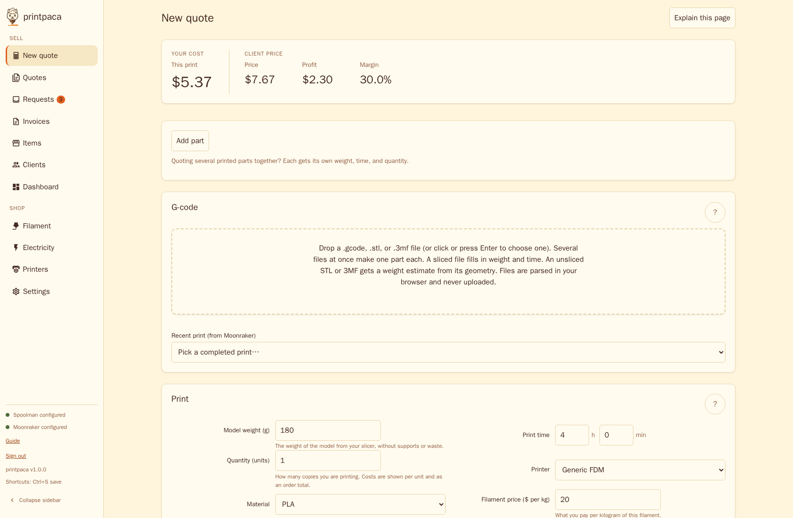
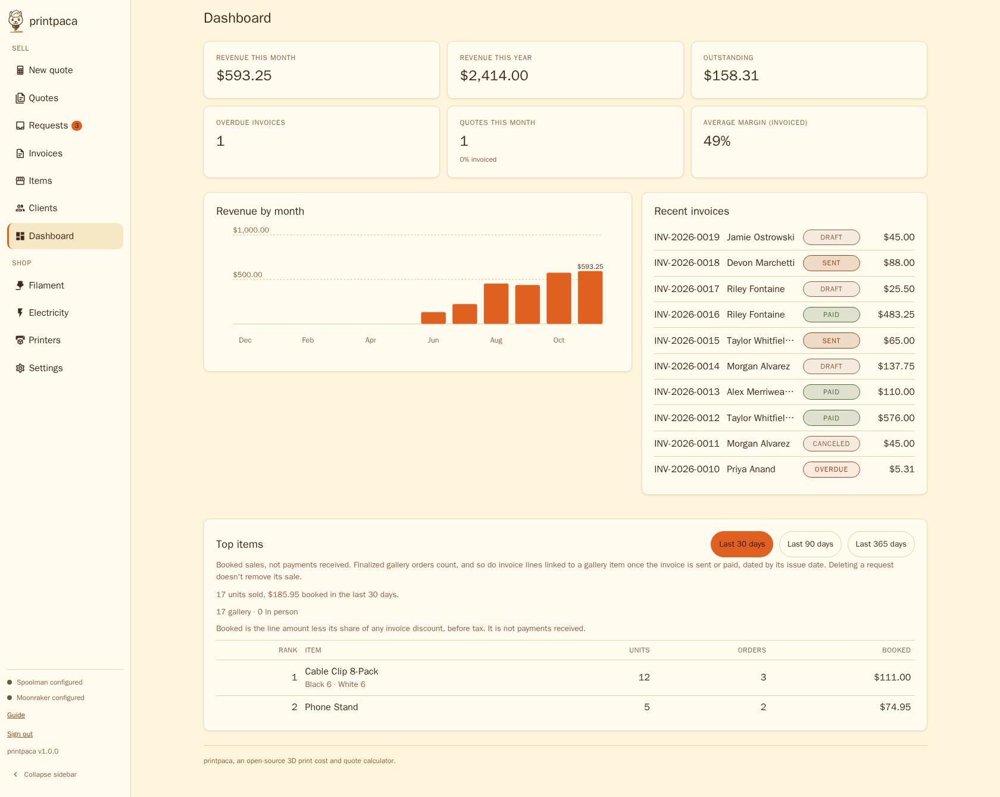

# Getting started

This guide walks you through running printpaca for the first time. It assumes no prior experience with Docker or editing configuration files.

To change how printpaca calculates or displays things after it's running, see [Configuration](configuration.md). To build from source or contribute, see the Development section of the [README](../README.md#development).

## What you need

- A computer that stays on while you use printpaca: a desktop PC, a home server, or a Raspberry Pi. printpaca stops responding when its computer is off or asleep.
- Docker:
  - On Windows or macOS, install [Docker Desktop](https://www.docker.com/products/docker-desktop/).
  - On Linux, install [Docker Engine](https://docs.docker.com/engine/install/) and its Compose plugin (usually the `docker-compose-plugin` package).

No accounts, licenses, or payment are involved. printpaca, Docker Desktop, and Docker Engine are free.

## Step 1: get the code

If you have `git`, clone the repository:

```bash
git clone https://github.com/SkilledAlpaca/printpaca.git
cd printpaca
```

If you don't have `git`, download the repository from [github.com/SkilledAlpaca/printpaca](https://github.com/SkilledAlpaca/printpaca): select **Code**, then **Download ZIP**, extract the archive, and open the extracted folder in a terminal.

If you don't want to build printpaca yourself, you still need the repository for `docker-compose.yml`, but you can pull the published image in step 3.

## Step 2: create the config folder

printpaca stores its settings and database in a folder on your computer so they survive restarts and updates. Create it before the first start:

```bash
mkdir -p ./config
```

The app inside the container runs as a limited user, not `root`, and that user must own this folder to write to it. Give it ownership, unless you're on Windows or macOS with Docker Desktop:

```bash
sudo chown 65532:65532 ./config
```

- **Windows or macOS with Docker Desktop**: skip the command. Docker Desktop's file sharing doesn't use Linux-style ownership, so the container can already write to the folder.
- **Linux, including WSL with your clone in the Linux filesystem**: run the command. These are real Linux mounts with real ownership.
- **WSL with your clone under `/mnt/c` or `/mnt/d`**: skip the command. Those paths go through Docker Desktop's Windows file sharing.

If you're not sure which case you're in, run the command anyway. It's harmless on a filesystem that ignores Unix ownership.

Run it only against `./config`, never against the whole cloned repository. `config/config.example.yaml` and `config/config.schema.json` are tracked by git, and changing their ownership breaks a later `git pull` with `Permission denied`. The command above isn't recursive, so it leaves them alone. The recovery and restore commands later in this guide are recursive (`chown -R`), and each is followed by a second command that restores your ownership of those two files.

If you skip the `chown` where it's needed, printpaca fails to start rather than running degraded; see [Common failure: config folder permissions](#common-failure-config-folder-permissions).

## Step 3: start printpaca

Start printpaca in the background, building its image the first time:

```bash
docker compose up -d --build
```

The first run downloads a base image and builds printpaca, which can take a few minutes. Success looks like the prompt returning with no error and a line such as `Container printpaca-printpaca-1  Started`.

**To pull the published image instead of building**, edit `docker-compose.yml`: comment out the `build:` and `image:` lines and uncomment `image: skilledalpaca/printpaca:latest`. Then run:

```bash
docker compose pull
docker compose up -d
```

`latest` tracks the newest stable release; use `skilledalpaca/printpaca:vX.Y.Z` to pin a version. The rest of this guide works the same either way.

Open [http://localhost:8080/admin/](http://localhost:8080/admin/). You should see the sign-in screen: printpaca is secure by default, so the calculator stays behind a password. Step 4 gets you that password. Customers see a different page: the front door at [http://localhost:8080/](http://localhost:8080/), with the shop at `/order`.

## Step 4: sign in

With no password configured, printpaca generates a random one the first time it starts. Find it:

```bash
docker compose logs printpaca
```

Look for a line like:

```
printpaca: Use this password to sign in: 6eNrXH5Yvhuf6Ehi7u2F
```

Enter it on the sign-in screen. The same password is saved to `./config/admin-password` and survives the container being recreated.

To choose your own password, add `ADMIN_PASSWORD` to `docker-compose.yml`'s `environment:` block, then run `docker compose up -d --build` again (`docker compose up -d` if you pull the image):

```yaml
    environment:
      - ADMIN_PASSWORD=your-password-here
```

**What the default exposes.** `docker-compose.yml` publishes printpaca on `127.0.0.1:8080`, reachable only from the computer running it. If you uncomment the LAN-wide `ports:` line so other devices can reach it, set your own `ADMIN_PASSWORD` or confirm the generated one first. Otherwise anyone who can reach the port has full access to every client, invoice, and payment record. See [Authentication](configuration.md#authentication) for the full picture, including the `ALLOWED_HOSTS` DNS-rebinding defense and how to opt out of authentication (not recommended).

## Is it working?

After step 4, check the following.

- **The container is running.** Run `docker compose ps`. Success is a row for `printpaca` with a status starting `Up`.
- **The server responds.** Open [http://localhost:8080/healthz](http://localhost:8080/healthz) or run `curl http://localhost:8080/healthz`. Success is a plain `ok`.
- **The app accepts your login.** Open [http://localhost:8080/admin/](http://localhost:8080/admin/) and enter the password from step 4. Success is the New quote calculator with a sidebar listing Dashboard, Invoices, Clients, and other sections.



If the container isn't `Up`, or `/healthz` doesn't respond, start with [Reading the logs](#reading-the-logs).

## Reading the logs

Every problem printpaca can't recover from, such as a bad `config.yaml`, a permissions problem, or a port conflict, writes one clear line to the container log and then stops. Read it with:

```bash
docker compose logs printpaca
```

If the container is crash-looping (its status alternates between `Restarting` and `Up`, or stays `Restarting`), the log holds the reason once per restart attempt. The most common messages:

- `config dir /config is not writable by this process (uid 65532): ...` followed by `Fix ownership on the host with: sudo chown -R 65532:65532 ...`: see [Common failure: config folder permissions](#common-failure-config-folder-permissions).
- `config: /config/config.yaml: yaml: line 3: mapping values are not allowed in this context` (or another `yaml:` message): `config.yaml` has invalid YAML syntax, usually inconsistent indentation. Compare it against [`config/config.example.yaml`](../config/config.example.yaml).
- `config: /config/config.yaml: yaml: unmarshal errors:` followed by `field <name> not found in type main.Config`: `config.yaml` has a key printpaca doesn't recognize, often a typo. Check the spelling and nesting against the example file.
- `config: invalid configuration:` followed by lines like `defaults.material: "abs" not in materials`: a setting refers to something that doesn't exist (here, an undefined material id). Fix the reference or add the missing entry.

Also check the logs after [updating](#updating-printpaca): a newer version can reject a `config.yaml` an older one accepted if a setting's rules changed.

### Common failure: port already in use

If something else on your computer uses port 8080, `docker compose up` fails with an error containing `port is already allocated`. In `docker-compose.yml`, change the `ports` line from `"127.0.0.1:8080:8080"` to a free port on the left side, for example `"127.0.0.1:8081:8080"`. Run `docker compose up -d --build` again and open `http://localhost:8081/admin/`.

### Common failure: config folder permissions

If step 2's `chown` was needed and skipped, or ran against the wrong folder, printpaca fails to start. `docker compose ps` shows the service stuck `Restarting`, and your browser can't connect, because the server exits before it listens. The log shows the following. The message is one long line; it's wrapped here for reading.

```
config dir /config is not writable by this process (uid 65532): open /config/.healthz-probe-3801338028: permission denied
Fix ownership on the host with: sudo chown -R 65532:65532 /config -- then, if
that directory is your cloned repo's config/ folder, restore your own
ownership of the two git-tracked files it also fixed: sudo chown
$(id -u):$(id -g) /config/config.example.yaml /config/config.schema.json
```

Run the fix on the host, not inside the container. If `./config` is your cloned repo's `config/` folder, the `-R` also changes the two git-tracked files, so restore your ownership of them right after:

```bash
sudo chown -R 65532:65532 ./config
sudo chown $(id -u):$(id -g) ./config/config.example.yaml ./config/config.schema.json
docker compose restart
```

### Common failure: Host not allowed (403)

If you reach the admin app through anything other than `localhost` or a bare IP address, such as a reverse proxy or a new hostname, and every page fails with `403` including the sign-in screen, the server is running and rejecting the request on purpose. `docker compose ps` still shows `Up`.

**Cause**: the main port (`PORT`) accepts only requests whose `Host` header is an IP literal, `localhost`, or a name in `ALLOWED_HOSTS`, a defense against DNS rebinding (see [Authentication](configuration.md#authentication)). The allowlist covers the front door and the shop as well as `/admin/`. A proxy that forwards your own hostname trips it the same way a malicious page would. The optional customer-only listener ([`PUBLIC_PORT`](configuration.md#public-quote-page)) has no `Host` allowlist.

**Fix**: add the hostname to `ALLOWED_HOSTS` in `docker-compose.yml`'s `environment:` block (comma-separated for more than one), then restart:

```yaml
    environment:
      - ALLOWED_HOSTS=printpaca.example.com
```

```bash
docker compose up -d --build
```

**What to look for**: the browser shows the plain-text body `Host not allowed. Set ALLOWED_HOSTS to a comma-separated list including this host (see README's Authentication section).`. The log names the rejected hostname, at most once a minute per hostname:

```
admin listener: rejected request for disallowed Host "printpaca.example.com"; set ALLOWED_HOSTS to include it if this host is legitimate (see README's Authentication section)
```

Each rejected request also appears as a `403` in the access log (`access admin "GET" "/" 403 ...`).

## Quote a walk-in customer

On the New quote page, turn on **Set a selling price**, then type the client's name in **Client (optional)**. The same name appears in the save row's client field, prints on the client quote, and is saved with the quote. When you save, a name that matches no client creates one, so repeat clients are linked automatically.

To email the quote, open the quote's row menu on the Quotes page and choose **Email quote**. If the quote has no client, or its client has no email on file, printpaca asks for an address, creates the client (or fills in the linked client's email), and sends the quote. This needs the Clients permission; without it the menu explains that you need Clients access to add an email. Converting the quote to an invoice keeps the client's name.

## Quote a multi-part order

An order can hold 1 to 20 parts, for example a bracket, its lid, and a bag of spacers for one customer. Each part has its own weight, print time, printer, material, quantity, and hardware. Fees, tax, shipping, and the customer are set once for the whole order.

1. On the New quote page, drop several sliced files onto the G-code box at once, or press **Add part**. Dropping several files makes one part per file, named after the file. Dropping a single file fills the part you are editing.
2. Select a part in the **Parts** list to edit it. You can rename, duplicate, or remove a part there.
3. Turn on **Set a selling price**. Margin or markup is applied to each part, and **Sale price override** sets a fixed per-unit price for the selected part only.
4. Fees and tax are calculated once on the whole order (tax is included in the price, as for a single part), and shipping is charged once. The summary bar and the **Order by part** table show each part and the order total.

A saved multi-part quote shows "N parts" in the Quotes list. **Print client quote** lists one line per part, then shipping and the total, and **Print cost audit** shows one breakdown per part. **Convert to invoice** creates one invoice line per part (named "quote label - part label") plus the Shipping line. **Email quote** sends the same lines. A quote with one part works as before. **Open in new quote** on a request starts a new one-part quote.

## Where your data lives

Everything printpaca saves lives in the `./config` folder from step 2:

- `config.yaml`: your settings, if you've changed any from the defaults. See [Configuration](configuration.md).
- `printpaca.db`: a SQLite database holding quotes, clients, invoices, payments, and requests. It runs in WAL mode, so `printpaca.db-wal` and `printpaca.db-shm` may sit beside it and must be backed up together with it.
- `admin-password`: the generated admin password from step 4, if you didn't set your own.
- `uploads/`: files visitors submit through the [public quote page](configuration.md#public-quote-page) (G-code, 3MF, or STL) and item-gallery images. A `.gcode` file is pruned 30 days after its request is finalized, and a 3MF or STL model file after 180 days, because printpaca can't regenerate a visitor's original model the way it can regenerate slicer output. Deleting a request removes its stored file immediately; item images are removed with their item.

To back up, stop printpaca, then copy the whole `config` folder. The folder is owned by uid `65532`, so a plain `cp -r` as your own user can't read the `0600` `admin-password` file. It prints `Permission denied`, exits nonzero, and leaves a backup without your admin password; a script that ignores the exit code misses that. Use `sudo cp -a`, which reads past the permission and preserves ownership:

```bash
docker compose stop
sudo cp -a ./config ./config-backup-$(date +%F)
docker compose start
```

Confirm the copy got everything:

```bash
ls ./config-backup-$(date +%F)/admin-password ./config-backup-$(date +%F)/printpaca.db
```

Both paths must exist (skip `admin-password` if you set your own `ADMIN_PASSWORD`). If either is missing, the backup is partial; rerun the `sudo cp -a` command.

The **Download data export** button on the Settings tab is a separate, one-way JSON export for your records; printpaca can't load it back. Copying `./config` is the only restorable backup.

The Quotes tab has its own **Export** and **Import** buttons for quote history. Import reads only files that printpaca exported (`{"version": 1, "quotes": [...]}`) and skips any entry missing its form state, status, status log, or part count.

### Restoring a backup

To restore a `config` folder you backed up earlier, after data loss or to roll back a change:

```bash
docker compose stop
mv ./config ./config-broken   # keep it until you've confirmed the restore worked
sudo cp -a ./config-backup-<date> ./config
sudo chown -R 65532:65532 ./config
sudo chown $(id -u):$(id -g) ./config/config.example.yaml ./config/config.schema.json
docker compose start
```

Use `sudo cp -a` here for the same reason as the backup. The `chown -R` still matters: a restore from another machine, or from a backup your own user touched, can leave files owned by the wrong uid, which reproduces [Common failure: config folder permissions](#common-failure-config-folder-permissions). Because `./config` is your clone's `config/` folder, the `-R` also changes the two git-tracked files, and the second `chown` restores your ownership of them so a later `git pull` doesn't fail.

Confirm the restore as in [Is it working?](#is-it-working), then remove `./config-broken`.

## Updating printpaca

**Back up first.** An update is one-way: the database schema only grows forward, and an older printpaca binary refuses to open a database a newer one has touched (the log reads `database schema version N is newer than this binary knows`). To go back to the previous version, restore your pre-update backup; there's no in-place downgrade.

Back up (see [Where your data lives](#where-your-data-lives)), then update using the route you started with.

If you pull the published image:

```bash
sudo cp -a ./config ./config-backup-$(date +%F)
docker compose pull
docker compose up -d
```

If you build from source:

```bash
sudo cp -a ./config ./config-backup-$(date +%F)
git pull
docker compose up -d --build
```

If you downloaded a `.zip` instead of using `git`, download a fresh one, extract it over your existing folder (or into a new one, copying your `config` folder in), then run `docker compose up -d --build` from that folder.

An update leaves your data in `./config` untouched. If the updated container doesn't come up, see [Reading the logs](#reading-the-logs).

## Stopping printpaca

```bash
docker compose down
```

Your data in `./config` survives, because it's a folder on your computer, not inside the container. Run `docker compose up -d --build` to start again.

## Starting over and uninstalling

To clear your data and keep your settings, stop printpaca, delete the database, and start again (a fresh database is created automatically):

```bash
docker compose stop
sudo rm -f ./config/printpaca.db ./config/printpaca.db-wal ./config/printpaca.db-shm
docker compose start
```

`sudo` is needed here and below because the container's uid `65532` owns these files, the same cause as [Common failure: config folder permissions](#common-failure-config-folder-permissions). The image has no shell, so you can't do this from inside the container.

To also return to the default configuration, delete `config.yaml` (and `config.yaml.bak`, if present) before starting:

```bash
sudo rm -f ./config/config.yaml ./config/config.yaml.bak
```

To remove printpaca entirely, back up first if you might want any data later, then run:

```bash
docker compose down --rmi all
sudo rm -rf ./config
```

`--rmi all` removes the image whether you built or pulled it. This is irreversible: once `./config` is gone, so is everything printpaca saved.

## Next steps

Open **Guide** from the link at the bottom of the sidebar for a walkthrough of quoting, invoicing, and getting paid. To change currency, pricing, business details, or optional features, see [Configuration](configuration.md). To expose printpaca over HTTPS, see [Running behind a reverse proxy](configuration.md#running-behind-a-reverse-proxy-https). To put printpaca on a real hostname without forwarding a port, see [Cloudflare Tunnel](cloudflare-tunnel.md).


